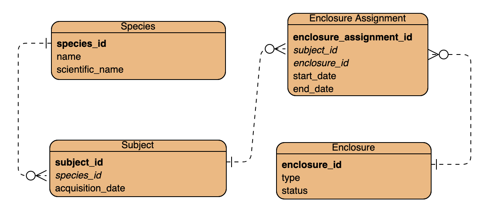

---
objectives:
  [
    'Explain the difference between DDL & DML in SQL',
    'Create and populate SQL tables',
    'Ensure data quality by defining database constraints.',
    'Improve query performance using indexes'
  ]
module: Advanced-Data
week: 1
workshop: true
---

import Tabs from '@theme/Tabs';
import TabItem from '@theme/TabItem';
import LearningObjectiveComponent from '@theme/LearningObjectiveComponent'
import LockedContent from "@theme/LockedContent";
import EmbeddedYoutubeVideo from "@theme/EmbeddedYoutubeVideo"

# Defining Databases

<LearningObjectiveComponent />

## Pre work

### Set up

If nobody has done so already, copy and paste this command into Slack.

```
/prework Defining Databases
```

### Watch - Acid Properties

:::info Task

Watch the video below on ACID properties:

<EmbeddedYoutubeVideo id="GAe5oB742dw" />

:::

### Research - Defining Data

:::info Task

Find answers to the following questions:

- What is the difference between 'DML' and 'DDL' SQL?
- What options does Postgres provide for storing text values? Which is the best?

You do not need to share your answers, but be prepared to discuss them in the workshop.

:::

### Research - Constraints

:::info Task

Research the different types of `constraint`s that can be applied to a Postgres table and column. For each, find out:

- What it does
- Why it is useful
- An example of how to use it

Share the examples in the Slack channel.

:::

## Workshop

<LockedContent password="ownership">

### Key Terms

**Ask** the trainees to share the definitions they found in the pre-work.

> - **DML**: Data Manipulation Language, used to manipulate data in a database.
> - **DDL**: Data Definition Language, used to define the structure of a database.

### Database setup

**Share** this ERD with the trainees



**Ask** them to guess what it is

**Reveal** after several guesses that it is in fact for Jurassic Park

**Connect** to postgres using `psql`.

**Create** a new database named `jurassic_park`.

### Table definitions

**Get** trainees to tell you the _minimal_ SQL to create some of the tables.

```sql
CREATE TABLE species (
  species_id INT,
  name VARCHAR(30),
  scientific_name VARCHAR(100)
);

CREATE TABLE subject (
  subject_id INT,
  species_id INT,
  acquisition_date DATE
);
```

**Highlight** the difference in names between the model and the SQL; explain the rationale behind your choices of names:

- All lowercase means less likelihood of later confusion
- Underscores instead of spaces ensure that the table names will work in most contexts without extra precautions

**Ask** trainees what problems this SQL might lead do/fail to prevent?

- Lack of primary keys could lead to data redundancy
- Duplicate IDs are possible
- Null values are allowed in every column
- No explicit foreign key relationship could lead to data errors

**Callback** to the idea of ACID properties and explain how these tables are not ACID-compliant.

**Pose** the question: why are these tables not ACID-compliant?

**Add** in some simple restrictions:

```sql
CREATE TABLE species (
  species_id INT GENERATED ALWAYS AS IDENTITY,
  name VARCHAR(30) NOT NULL,
  scientific_name VARCHAR(100) UNIQUE NOT NULL,
  PRIMARY KEY (species_id)
);

CREATE TABLE subject (
  subject_id INT GENERATED ALWAYS AS IDENTITY,
  species_id INT NOT NULL,
  acquisition_date DATE DEFAULT CURRENT_DATE,
  PRIMARY KEY (subject_id),
  FOREIGN KEY (species_id) REFERENCES species(species_id)
);
```

**Explain** the term 'constraint', and explain that primary/foreign keys, data types, and the use of `UNIQUE`/`NOT NULL`/`DEFAULT` are all examples of the same.

### Constraints

**Add** a constraint to a table:

```sql
CREATE TABLE subject (
  subject_id INT GENERATED ALWAYS AS IDENTITY,
  species_id INT NOT NULL,
  acquisition_date DATE DEFAULT CURRENT_DATE CHECK (acquisition_date <= CURRENT_DATE),
  PRIMARY KEY (subject_id),
  FOREIGN KEY (species_id) REFERENCES species(species_id)
);
```

**Demonstrate** that invalid data fails the check by `INSERT`ing a subject acquired next week.

**Add** a _named_ constraint to a table, showing how this allows not just human-readable constraint names, but also multi-column constraints:

```sql
CREATE TABLE species (
  species_id INT GENERATED ALWAYS AS IDENTITY,
  name VARCHAR(30) NOT NULL,
  scientific_name VARCHAR(100) UNIQUE NOT NULL,
  PRIMARY KEY (species_id),
  CONSTRAINT no_human_subjects CHECK (
    LOWER(name) != 'human'
    AND LOWER(scientific_name) NOT LIKE 'homo %'
  )
);
```

**Demonstrate** what happens when you attempt to violate this constraint.

**Highlight** and rejoice at the park finally having at least one ethical guideline.

**Highlight** the value of constraints: a well-constructed database can _ensure_ high-quality data.

**Answer** any trainee questions on constraints and related topics.

### Challenge

**Add** the following two tables

```sql
CREATE TABLE enclosure_assignment(
    subject_id INT,
    enclosure_assignment INT,
    start_date DATE,
    end_date DATE
)

CREATE TABLE enclosure(
    type text,
    status text,
)
```

**Challenge** trainees to

> - Ensure all data types are appropriate
> - Ensure all primary and foreign keys are setup correctly
> - Ensure that `status` can only have 'available','occupied','maintenance' in it
> - Ensure all columns have good non-null settings and good defaults
> - Ensure all dates are verified as being appropriate
> - Add a `max_occupancy` column, and ensure it is only set to a maximum of three
> - Ensure that type is not empty
> - Ensure that a subject cannot be assigned to two enclosures at the same time

### Performance

**Load** some dummy data into the database

```sql
INSERT INTO species
    (name, scientific_name)
VALUES
    ('Tyrannosaurus', 'Tyrannosaurus rex'),
    ('Triceratops', 'Triceratops horridus'),
    ('Velociraptor', 'Velociraptor mongoliensis'),
    ('Stegosaurus', 'Stegosaurus stenops'),
    ('Brachiosaurus', 'Brachiosaurus altithorax'),
    ('Apatosaurus', 'Apatosaurus ajax'),
    ('Allosaurus', 'Allosaurus fragilis'),
    ('Spinosaurus', 'Spinosaurus aegyptiacus'),
    ('Giganotosaurus', 'Giganotosaurus carolinii'),
    ('Archaeopteryx', 'Archaeopteryx lithographica'),
    ('Diplodocus', 'Diplodocus carnegii'),
    ('Compsognathus', 'Compsognathus longipes'),
    ('Ankylosaurus', 'Ankylosaurus magniventris'),
    ('Iguanodon', 'Iguanodon bernissartensis'),
    ('Pachycephalosaurus', 'Pachycephalosaurus wyomingensis'),
    ('Parasaurolophus', 'Parasaurolophus walkeri'),
    ('Oviraptor', 'Oviraptor philoceratops'),
    ('Therizinosaurus', 'Therizinosaurus cheloniformis'),
    ('Utahraptor', 'Utahraptor ostrommaysi'),
    ('Deinonychus', 'Deinonychus antirrhopus'),
    ('Carnotaurus', 'Carnotaurus sastrei'),
    ('Gallimimus', 'Gallimimus bullatus'),
    ('Troodon', 'Troodon formosus'),
    ('Maiasaura', 'Maiasaura peeblesorum'),
    ('Edmontosaurus', 'Edmontosaurus annectens'),
    ('Ceratosaurus', 'Ceratosaurus nasicornis'),
    ('Kentrosaurus', 'Kentrosaurus aethiopicus'),
    ('Suchomimus', 'Suchomimus tenerensis'),
    ('Plateosaurus', 'Plateosaurus engelhardti'),
    ('Corythosaurus', 'Corythosaurus casuarius'),
    ('Euoplocephalus', 'Euoplocephalus tutus'),
    ('Thescelosaurus', 'Thescelosaurus neglectus')
;

WITH species_data AS (
    SELECT 'Species ' || generate_series(1, 1000000) AS name,
                 'Scientific Name ' || generate_series(1, 1000000) AS scientific_name
)
INSERT INTO species (name, scientific_name)
SELECT name, scientific_name
FROM species_data;
```

**Run** the following query to see how long it takes to run:

```sql
SELECT DISTINCT s.name FROM species s;
```

**Reflect** that it seemed pretty fast, but that as engineers we should measure and not just feel.

**Use** `explain` to show the query plan:

```sql
EXPLAIN SELECT DISTINCT s.name FROM species s;
```

**Observe** that the query is doing a full table sequence scan, which is slow.

**Ask** the trainees to theorise why this is slow.

**Explain** that the database has to read every row in the table to find the one we want. We can use an index to make it use a more efficient method - a binary search.

**Add** an index to the `species` table:

```sql
CREATE INDEX species_name_idx ON species (name);
```

**Run** the query again and `explain` it.

**Observe** that the query is now using the index, which is much faster.

**Ask** the trainees to reflect on the performance difference and what the trade-off might be

- Indexes make reads faster but writes slower because the index has to be updated
- Indexes take up space because they are a separate data structure

### Challenge

**Task** the trainees with

> Write a SQL command for one of the other columns in the database to add an `index`

### Wrap-up

**Encourage** the trainees to realise that data models can always be extended and improved. There's no 'perfect', there is only 'good enough for our current needs'.

**Discuss** with the trainees approaches and issues encountered.

</LockedContent>
