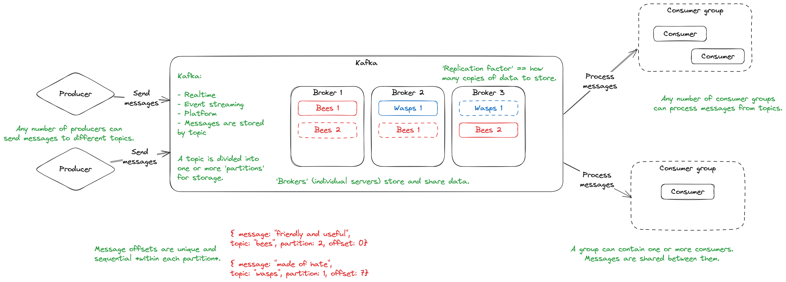

---
objectives:
  [
    'Explain the use cases of stream-processing platforms/tools',
    'Publish messages to a Kafka topic',
  ]
module: Advanced-Data
week: 2
workshop: true
title: Stream Processing
---

import Tabs from '@theme/Tabs';
import TabItem from '@theme/TabItem';
import LearningObjectiveComponent from '@theme/LearningObjectiveComponent'
import LockedContent from "@theme/LockedContent";

<LearningObjectiveComponent />

## Pre work

### Set up

If nobody has done so already, copy and paste this command into Slack.

```
/prework Stream Processing
```

### Research

:::info Task

Research **Apache Kafka**, finding answers to the followinq questions:

1. What is it?
2. What are its main advantages/drawbacks?
3. How does it work?

Put your answers in the Slack thread.

:::

### Reading

:::info Task

Explore the [confluent-kafka](https://docs.confluent.io/platform/current/clients/confluent-kafka-python/html/index.html) documentation.

What does it allow you to do? What configuration does it need? What controls are exposed to you?

:::

### Annotation

:::info Task

Take a copy of the below code and store it in a file.

```py
"""A small example of a Kafka producer."""

from os import environ

from dotenv import load_dotenv
from confluent_kafka import Producer


if __name__ == "__main__":

    load_dotenv()

    kafka_producer = Producer({
        "bootstrap.servers": environ["BOOTSTRAP_SERVERS"],
        'security.protocol': environ["SECURITY_PROTOCOL"],
        'sasl.mechanism': environ["SASL_MECHANISM"],
        'sasl.username': environ["USERNAME"],
        'sasl.password': environ["PASSWORD"]
    })
```

Annotate it carefully. What is happening on each line? What is the overall result?

:::

## Workshop

<LockedContent password="ownership">

### Setup

**Obtain** the Kafka cluster credentials.

**Create** a `.env` file containing them:

```sh
BOOTSTRAP_SERVERS=XXXXXXXXXX
SECURITY_PROTOCOL=SASL_SSL
SASL_MECHANISM=PLAIN
USERNAME=XXXXXXXXXX
PASSWORD=XXXXXXXXXX
GROUP=1
AUTO_OFFSET=latest
TOPIC=cohort
```

### Introduction

**Introduce** the [pub-sub pattern](https://en.wikipedia.org/wiki/Publish%E2%80%93subscribe_pattern).

**Explain** that this is a common pattern in Advanced Data for handling high-volumes or realtime data.

**Introduce** Kafka as one implementation of this model amongst many.

### Kafka

**Talk** through the core concepts of Kafka:

- A cluster of nodes sharing data between them
- Producers sending messages to particular **topics**
- Messages being stored on **partitions** within topics
- Each message having an **offset** within its partition & topic
- Groups of consumers processing each message

**Draw** the process out while explaining it; it helps to visualise.



### The cluster

**Show** trainees the cluster on [Confluent Cloud](https://confluent.cloud).

**Point** out the `lmnh` topic (relevant for the coursework) and the `cohort` topic (used in this workshop).

**Explain** that any messages produced are sent here, and any messages consumed are taken from here.

**Show** some messages from one of the topics - note the timestamp, offset, and value.

### Producing

**Introduce** [confluent-kafka](https://docs.confluent.io/kafka-clients/python/current/overview.html) as a library that allows communicating with Kafka clusters from Python.

Create a `producer.py` file:

```python
"""A small example of a Kafka producer."""

from os import environ

from dotenv import load_dotenv
from confluent_kafka import Producer


if __name__ == "__main__":

    load_dotenv()

    kafka_producer = Producer({
        "bootstrap.servers": environ["BOOTSTRAP_SERVERS"],
        'security.protocol': environ["SECURITY_PROTOCOL"],
        'sasl.mechanism': environ["SASL_MECHANISM"],
        'sasl.username': environ["USERNAME"],
        'sasl.password': environ["PASSWORD"],
        'logger.level': 3
    })
```

**Explain** that the above code creates a **producer**: an object that can send messages to a given Kafka topic. Note that the logger level simply filters out the Telemetry messages that Kafka can often generate and obscure our terminal output with. Level 3 will still allow Errors through.

**Warn** that this, on its own, does nothing: we have the capability to send a message, but we haven't actually done it yet.

### Challenge

**Challenge** trainees to send a message including their own name to the `cohort` topic.

**Encourage** them to use the `confluent-kafka` documentation to guide them.

**Grant** trainees no more than 10 minutes to get this working.

**Keep** the Confluent Kafka page open to the topic and shared, so that successful messages can be seen.

**Gather** trainees back together and discuss the code to send messages.

```py
    kafka_producer.produce(topic="cohort", value="Hello!")

    kafka_producer.flush()  # Waits for all messages to be sent.
```

**Highlight** the following:

- The arguments required for `.produce()`
- The use of `.flush()` to ensure that all messages are sent

**Demonstrate** that running this file adds a message to the `cohort` topic.

**Highlight** to trainees that the producer is just Python code; there's nothing special about it, and it could be part of any larger program. A producer isn't a special kind of script, but term for any application that sends messages to a Kafka cluster.

### Conclusion

**Gather** and answer outstanding Kafka questions.

**Play** a quick recap game by making Kafka-related statements and getting trainees to signal True or False.

- A cluster can have multiple brokers (True)
- A producer can only write to one topic (False)
- Different consumers can read the same message (True)
- Every broker in a cluster holds a full copy of every topic's data (False)
- ...

</LockedContent>
