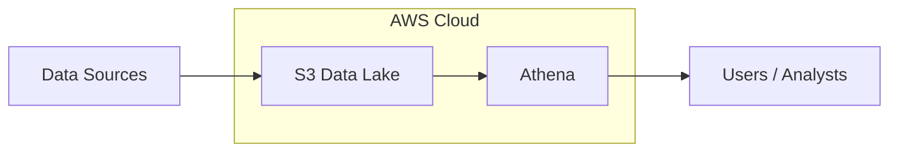

import Tabs from '@theme/Tabs';
import TabItem from '@theme/TabItem';
import LearningObjectiveComponent from '@theme/LearningObjectiveComponent'
import LockedContent from "@theme/LockedContent";

<LearningObjectiveComponent />

## Pre work

### Set up

If nobody has done so already, copy and paste this command into Slack.

```
/prework truck Case Study
```

### Research - Case Study

The next two weeks of the course are focused on meeting the requirements of a single case study. Take the time now to get familiar with the context you'll be working within.

:::info Task

Read the case study carefully.

What questions do you have? What issues do you anticipate?

In the slack thread, write a few questions that you would ask your stakeholders

:::

### Research - Data Lakes

:::info Task

Research online for the following terms:

- What is a data lake?
- What are the benefits of a data lake?
- What are the drawbacks of a data lake?

:::

### Research - Parquet

:::info Task

Research online for the following terms:

- What is Parquet?
- What are the benefits of Parquet?
- What are the drawbacks of Parquet?

:::

### Experiment

:::info Task

Access S3 through the AWS web console.

Download a file from any bucket and check that you can open it on your device.

:::

### Submission

:::info Submission

Please share your answers in the Slack thread.

:::

## Workshop

<LockedContent password="ownership">

### Case Study

**Ask** trainees to explain what they're being asked to do.

**Correct** any misconceptions.

**Emphasise** the importance of understanding the _purpose_ of a project at all times: who will this benefit? Why is this the best solution?

**Task** the trainees with coming up with a list of the problems they will have to solve in this week. Below are some ideas

> - How is MySQL different to other dialects?
> - How will we load the data?
> - etc.

**Ensure** that at least the following topics come up

> - What is MySQL?
> - What is a data lake?
> - What is parquet?

### MySQL

**Introduce** MySQL as (yet) another dialect of SQL.

**Explain** that you're actually going to explain very little; part of being an effective engineer is being able to pick up new tools as required, and they've now had enough experience with various SQL dialects & tools that they should be able to handle this challenge.

**Relent** and briefly show them how to connect to `mysql` from the command line.

`mysql [name of database]` (the default DB is `mysql`)

**Indulge** them further by also showing a few key commands:

- `show databases;`
- `show tables;`
- `use [name of database];`

**Tell** them that learning more about MySQL will be useful not just in the coursework but as practice for learning future libraries.

### Data Lakes

**Introduce** the concept of a data lake.

> Put simply, a data lake is a storage repository that holds a vast amount of raw data in its native format until it is needed. A can data lake use a flat architecture to store data or use folders or files to organize the data.

**Explain** that the benefits of a data lake are

> - It can store structured, semi-structured, and unstructured data
> - It can store data at any scale (basically, unlimited)
> - It can be much cheaper than a traditional data warehouse

**Posit** the problem of how would you store an image in a traditional database.

> - You could store the image as a blob, but that would be inefficient
> - You could store the image as a URL, but that would still require it to be stored elsewhere
> - You could convert the image to a base64 string, but that would be inefficient

**Explain** that a data lake can store the image as an image, and that a tool like Athena (or others) can query that image.

**Explain** that the drawbacks of a data lake are

> - It can be difficult to manage
> - It can be difficult to query

**Explain** that the data lake is a place where data is stored in its raw form, and that a tool like Athena allows you to query that data.

**Explain** the below architecture that includes a data lake using S3 and Athena.



**Leave** time and space for questions and discussion.

### Parquet

**Introduce** the concept of Parquet.

**Explain** that Parquet is a columnar storage format, similar to how a data warehouse stores data.

**Explain** that the benefits of Parquet are

> - It is efficient for queries
> - It is efficient for storage as it is compressed

**Compare** Parquet to an image file in the way that it can only be opened by specific tools, as it is compressed

**Explain** that Parquet is a good format for storing data in a data lake, as it is efficient for storage and querying.

</LockedContent>
