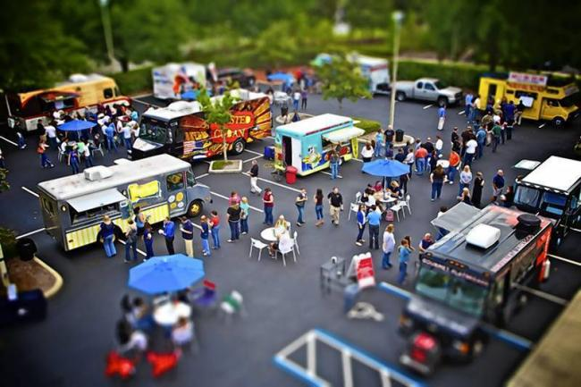

We're one week into the T3 project, and we've already made lots of progress. Two of the project's core pieces - the dashboard and the Data Lake - are already in place.

This week, we'll build on that existing structure, adapting the pipeline to pull in current and future data from the trucks. We'll also add a new report generation task, which will email out a summary of the previous day's transactions.

You'll set up your pipeline to trigger regularly, pulling in updated transaction files and ensuring that the dashboard is always working with the most recent data. Every morning, a summary report on the previous day will be emailed out to the T3 CEO.

## Working with Updating Data

Now that we have a proof-of-concept running, T3 have given us access to up-to-date truck data.

Each truck reports on transaction data at 3-hour intervals, writing new data to the Database. If a truck makes no transactions during a particular period, no data is created. This is a process known as [Batch Processing](https://www.geeksforgeeks.org/difference-between-batch-processing-and-stream-processing/).

## Workflows

Within the new larger pipeline, there are three separate workflows:

1. A scheduled ETL pipeline task, that reads data from the RDS and uploads a clean version to the Data Lake.
2. An always-on dashboard service, which allows users to explore the latest data from the Data Lake.
3. A scheduled report generation task, that reads data from the Data Lake and emails out a summary.

Although each of these workflows connects to the same Data Lake, they should otherwise be **independent**; each should be able to run on its own, and only major rewrites to any one workflow should have any impact on the others.

The pipeline is a series of tasks that run in sequence, each one performing a specific function. The pipeline is designed to be modular, so that each task can be run independently and in parallel with the others.

Each workflow should be scheduled to run at appropriate intervals. The ETL pipeline should run every 3 hours, shortly after the trucks are expected to report their data. The report generation task should run once a day, early in the morning.

## Technical Stack

The technical stack for this week's challenge is similar to last week's, with a few additions:

- **ETL Pipeline**: An ECS Fargate task that runs the ETL script to pull data from the RDS and upload it to the Data Lake.
- **Dashboard**: A continuously running service that reads data from the Data Lake and serves it via a web interface.
- **Report Generation**: An AWS Lambda function that reads data from the Data Lake and generates a summary report, which is then emailed out using AWS SES.

:::caution

Some of the infrastructure for this week has already been provided for you. You don't need to recreate your own copy of any existing resources (e.g. ECS clusters) that already do what you need.

Effective deployment involves creating the minimum working infrastructure you need; don't duplicate effort, and don't overcomplicate things.

:::
