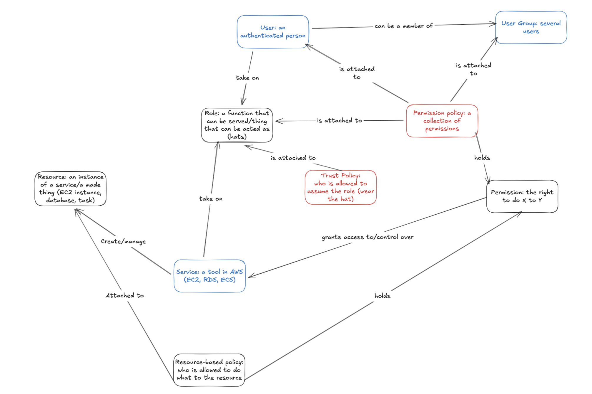

import Tabs from '@theme/Tabs';
import TabItem from '@theme/TabItem';
import LearningObjectiveComponent from '@theme/LearningObjectiveComponent'
import LockedContent from "@theme/LockedContent";

<LearningObjectiveComponent />

## Pre work

### Set up

If nobody has done so already, copy and paste this command into Slack.

```
/prework AWS Permissions
```

### Research

:::info Task

Find definitions for the following terms within an AWS context:

- IAM user
- Role
- Policy

:::

### Explore

:::info Task

Access AWS IAM and explore your own user account.

What permissions do you have? Where do they come from? What limitations do you notice?

:::

### Experiment

:::info Task

Create a new permissions policy. This policy should have the ability to send emails using SES V2, but only involving the `sl-coaches@proton-me` identity.

:::

### Submission

:::info Submission

Please share your answers in the Slack thread.

Include a link to your new policy.

:::

## Workshop

<LockedContent password="ownership">

### Auth & Auth

**Ask** trainees to explain the below terms:

- **Authentication**: are you who you say you are?
- **Authorisation**: are you allowed to do that?

**Explain** that these concepts need to work together; you can't authorise someone if you don't know anything about who they are.

**Introduce** the [Principle of Least Privilege](https://en.wikipedia.org/wiki/Principle_of_least_privilege): the best way to manage security is to give the minimal access required to the minimal number of actors. Explain that trainees should follow this principle throughout the course and their careers.

**Remind** trainees that AWS IAM manages auth for AWS services.

### IAM

**Create** a new Excalidraw.

**Draw** out the relationships between users, roles, policies, and permissions in IAM. Use the diagram below as a guide.



**Get** trainees to assist you as much as possible, explaining the relationships between the different actors.

### Policies and Permissions

**Talk** through the policies created in the pre-work. Ask trainees to explain how they constructed them.

**Show** a trainee's IAM user and the added policies.

**Select** the user's `PowerUserRegionLocked-EU-West-2` policy and show the permissions JSON.

**Ask** trainees to explain the different sections of the policy:

- The permission(s)
- The resource(s)
- The condition(s)

**Explain** that every permissions policy is structured like this, allowing very fine-grained control of access.

### Challenge

**Challenge** trainees to do the following:

> Update your permissions policy from the pre-work. This policy should now also be able to list the contents of any S3 bucket that begins with the word 'sigma'.

### Roles

**State** that so far, we have mostly focused on direct permissions: a human authenticates as a particular IAM account, and then takes actions allowed by their attached policies. This is not the only way.

**Pose** the question of how do we handle automated tasks, when a user can't (or doesn't want) to be involved. Accept the answer of 'roles'.

**Remind** trainees that a role is something *taken on* by other AWS **principals**, generally AWS services that need to act independently.

**Ask** trainees for examples of this:

- An ECS cluster running tasks/services
- An EventBridge schedule starting another service
- (Not encountered yet) a Lambda function that needs to access other services using code

**Explain** that a role needs at least two policies:

1. One or more permissions policies defining what the role is authorised to do
2. A trust policy explaining who can take the role on

**Use** the metaphor of a medieval monarch's crown. Wearing one means people will treat you as a monarch, but the wrong person trying to wear one is treason.

**Show** any role on IAM and talk through the trust policy.

### Challenge

**Challenge** trainees to do the following:

> Create a new role. This role should be adoptable by EventBridge schedules, and be allowed to send emails using SES V2.

**Discuss** how trainees found the role creation process.

**Reassure** them that roles are generally automatically created when you make other resources, so manual creation will not be required often.

**Warn** that automatic creation is not always accurate, so editing roles is a likely task for the future.

### Conclusion

**State** that understanding how to practically work with permissions on AWS is a vital part of building complex systems.

**Encourage** trainees to experiment with this throughout the coursework.

</LockedContent>
