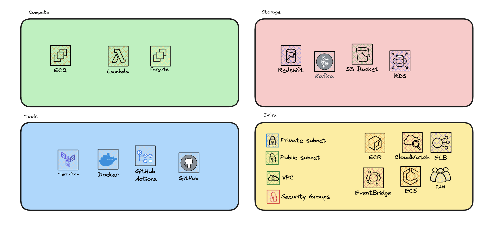

import Tabs from '@theme/Tabs';
import TabItem from '@theme/TabItem';
import LearningObjectiveComponent from '@theme/LearningObjectiveComponent'
import LockedContent from "@theme/LockedContent";

<LearningObjectiveComponent />

## Pre work

:::info Task

Consider the list of technologies that you've used through the course

- Database (Postgres, RDS)
- Datawarehouse (Redshift)
- EC2
- S3
- Lambda
- ECS Fargate (Services and Tasks)
- Docker
- Kafka
- Step Functions
- Terraform
- Cloudwatch
- IAM
- Load Balancers (ELB)
- CI/CD (Github Actions)
- Important Python libraries (e.g. Pandas)
- etc

For the list above - and any other tools/technologies/platforms you think of - write out the following

- In your own words, what is it and how does it work internally?
- What are the benefits of using it?
- What are the drawbacks - if any - of using it?

Prepare to share these in the workshop

:::

## Workshop

<LockedContent password="ownership">

**Create** a copy of this Excalidraw

> https://link.excalidraw.com/l/6gPaBlSh8PG/AD8j99fY7tg

**Tell** the trainees to spend five minutes, individually categorising the services below into either

> **Compute**. It's a computer that you can configure to do something.
> **Storage**. It stores data in a permanent way.
> **Infrastructure**. It helps to wire other things together.
> **Tool**. It helps to automate or make a process easier.

**Walkthrough** the decisions that the trainees made, ending at something like this

**Reiterate** that we could in fact use anything in these bucket fairly interchangeably. For example

> We could install Postgres on an EC2 to make an RDS
> We could setup an EC2 to start up and shut down on events, like a lambda
> We could use S3 to store data that we query like a Database
> etc

**Ask** the trainees why this might be a bad idea

> It's a massive waste of time and money. We're paying for the privilege of managing these services ourselves, when we could be using a managed service that does it for us.
> We're also introducing a lot of complexity and potential for error. We're not experts in managing these services, so we're likely to make mistakes.
> We're also not taking advantage of the benefits of these services. For example, RDS has automatic backups, scaling, and monitoring built in. If we use an EC2 with Postgres, we're not getting any of that.

**Ask** the trainees to list the benefits and drawbacks of different compute services. Filtering across Cost, Speed/Availability, Complexity, and Scalability

| Compute Service | Cost                                                                                                                 | Speed/Availability                                                                                    | Complexity                                                                                                                      | Scalability                                                                                                  |
| --------------- | -------------------------------------------------------------------------------------------------------------------- | ----------------------------------------------------------------------------------------------------- | ------------------------------------------------------------------------------------------------------------------------------- | ------------------------------------------------------------------------------------------------------------ |
| EC2             | Moderate. EC2 instances can be cost-effective, but costs can increase with higher usage and additional services.     | High. EC2 provides high availability and can be configured for high performance.                      | High. Managing EC2 instances requires handling infrastructure, scaling, and maintenance.                                        | High. EC2 can scale vertically and horizontally, but requires manual configuration or automation scripts.    |
| ECS Fargate     | Moderate. Fargate pricing is based on the resources used, which can be cost-effective for certain workloads.         | High. Fargate offers high availability and quick deployment times.                                    | Moderate. Fargate abstracts much of the infrastructure management, but still requires understanding of container orchestration. | High. Fargate can automatically scale based on the defined parameters and workload demands.                  |
| Lambda          | Low. Lambda charges based on the number of requests and execution time, making it cost-effective for many use cases. | Very High. Lambda functions are highly available and can scale instantly to handle incoming requests. | Low. Lambda abstracts all infrastructure management, allowing developers to focus on code.                                      | Very High. Lambda automatically scales with the number of incoming requests without any manual intervention. |

**Ask** the trainees to list the benefits and drawbacks of different storage services. Filtering across Cost, Speed, Complexity, Scalability, Flexibility.

| Storage Service | Cost                                                                                                                                           | Speed                                                                              | Complexity                                                                              | Scalability                                                                        | Flexibility                                                                                                   |
| --------------- | ---------------------------------------------------------------------------------------------------------------------------------------------- | ---------------------------------------------------------------------------------- | --------------------------------------------------------------------------------------- | ---------------------------------------------------------------------------------- | ------------------------------------------------------------------------------------------------------------- |
| S3              | Low. S3 is cost-effective for storing large amounts of data.                                                                                   | High. S3 provides high-speed access to stored data.                                | Low. S3 abstracts much of the storage management, making it easy to use.                | High. S3 can scale to store petabytes of data and handle high request rates.       | High. S3 can store any type of data, from small objects to large files, and supports various storage classes. |
| RDS             | Moderate. RDS pricing is based on the database engine, instance size, and storage capacity, which can be cost-effective for certain workloads. | High. RDS provides high-speed access to stored data.                               | Low. RDS abstracts much of the database management, making it easy to use.              | High. RDS can scale to store large volumes of data and handle high request rates.  | Low. RDS is designed for relational databases and may not be suitable for all types of data.                  |
| Redshift        | High. Redshift pricing is based on the node type and number of nodes, which can be cost-effective for certain workloads.                       | High. Redshift provides high-speed access to stored data by using parallelisation. | Low. Redshift abstracts much of the data warehousing management, making it easy to use. | High. Redshift can scale to store petabytes of data and handle high request rates. | Low. Redshift is designed for data warehousing and may not be suitable for all types of data.                 |

**Briefly** cover the ways that Redshift can be faster than an RDS

> By using columnar storage, Redshift can read only the columns that are needed for a query, reducing the amount of data that needs to be read from disk. This can result in faster query times and lower costs for storage and processing.
> Redshift also uses parallel processing to distribute queries across multiple nodes, allowing it to process large volumes of data quickly and efficiently. This can result in faster query times and improved performance for complex queries.

**Quickly** run through what each of the tools/infrastructure do in the Excalidraw.

> **Tools**
>
> - Terraform. Infrastructure as code, allows us to define and manage our infrastructure using code.
> - Docker. Containerisation, allows us to package and run applications in isolated environments.
> - Github Actions. CI/CD, allows us to automate the build, test, and deployment of our applications.
> - Github. Version control, allows us to track changes to our code and collaborate with others.
>   **Infra**
> - VPC. Virtual Private Cloud, allows us to define our own network in the cloud.
> - Subnets. Logical divisions of a VPC, allow us to isolate resources within our network.
> - Security Groups. Virtual firewalls, allow us to control inbound and outbound traffic to our resources.
> - EventBridge. Event-driven architecture, allows us to route events between services.
> - CloudWatch. Monitoring and logging, allows us to monitor and log our resources in the cloud.
> - IAM. Identity and Access Management, allows us to control access to our resources.
> - ECS. Provisioning and scaling, allows us to run and scale containerised applications.
> - ECR. Container registry, allows us to store and manage container images.

**Focusing** in on the tools. Run through the benefits and drawbacks of each

| Tool           | Benefits                                                                                                                                                                                                                                   | Drawbacks                                                                                                                                                                                                          |
| -------------- | ------------------------------------------------------------------------------------------------------------------------------------------------------------------------------------------------------------------------------------------ | ------------------------------------------------------------------------------------------------------------------------------------------------------------------------------------------------------------------ |
| Terraform      | - Infrastructure as code; allows us to define and manage our infrastructure using code. - Supports multiple cloud providers, increasing flexibility. - Enables version control and collaboration on infrastructure configurations. | - Steep learning curve; requires understanding of cloud services and best practices. - Misconfigurations can lead to significant issues. - State file management can become complex in large environments. |
| Docker         | - Enables containerisation; packages applications in isolated environments. - Enhances portability across different systems. - Simplifies dependency management and deployment processes.                                          | - Requires knowledge of containerisation concepts, adding learning overhead. - Can introduce complexity with orchestration tools. - Potential security risks if images are not managed properly.           |
| GitHub Actions | - Automates build, test, and deployment workflows (CI/CD). - Seamless integration with GitHub repositories. - Offers a marketplace for reusable workflows and actions.                                                             | - Limited to GitHub repositories; less flexible for other platforms. - Complex setups can be challenging to configure. - May have limitations in handling complex deployment scenarios.                    |

**Leave** plenty of times for questions and discussion

</LockedContent>
