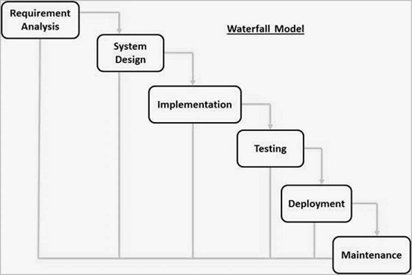
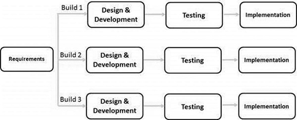
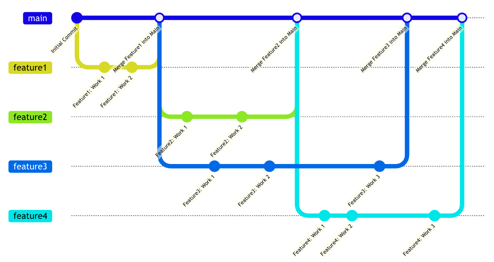

---
objectives:
  [
    'List the component parts of a user story',
    'Create a ticket in a Project Management board',
    'List the different parts of a well specified ticket',
    'Convert a user story into a ticket',
    'Describe the difference between Git Flow and Github Flow',
    'Use VSCode to resolve Git conflicts',
    'Open a pull request from Github',
    'Merge a pull request from Github',
    'Comment on a pull request from Github'
  ]
module: Advanced-Data
week: 5
workshop: true
title: 'Roles, Stories, Tickets & Git'
---

import LearningObjectiveComponent from '@theme/LearningObjectiveComponent'
import LockedContent from "@theme/LockedContent";

<LearningObjectiveComponent />

## Prework

### 1. Meet Your Team (5 mins)

You should already know who you'll be working with but if not, teams will be assigned now.

### 2. Assign Roles (~5 minutes)

In the real world, different people will have different roles in a software development team. For example, you would have a Project Management whose entire job is ensure the project runs well or you might have an Architect whose entire job is to design the architecture of systems.

However, as we have small teams (and ultimately want you to to be technical professions) you will be playing two roles. The role of an Engineer **and** the additional secondary role.

In this project _everyone_ will be playing the role of an [Engineer & Analyst](/Advanced-Data/Group%20Project/Roles/engineer) but you will either have a role as

- [Project Manager](/Advanced-Data/Group%20Project/Roles/project_manager) or
- [QA Tester](/Advanced-Data/Group%20Project/Roles/quality_assurance) or
- [Architect & DevOps](/Advanced-Data/Group%20Project/Roles/architect) or
- [Data & Business Analyst](/Advanced-Data/Group%20Project/Roles/analyst)

In your teams, **assign roles to everyone**. Don't worry too much, you'll have another chance to take a role next week. If you have more people than roles above then double up on the roles.

### 3. Discover Your Role (20 mins)

Spend some time reviewing the material in the descriptions above relating to the role that you'll be playing. Build some knowledge of what your role will be doing in this project.

### 4. Review Project

Finally, [review the project that you'll be completing as a team this week](../00-brief.md)

## Workshop

<LockedContent password="ownership">

:::info

This is a long, 3 hour workshop that will take up the whole morning. Make sure to take breaks and keep the energy up.

:::

**Elicit** any questions from the trainees that they may have about the project or role

**Outline** the idea of a RACI matrix and how each role is accountable for different parts of the project

> - Responsible: Those who do the work to achieve the task.
> - Accountable: The one ultimately answerable for the correct and thorough completion of the deliverable or task, and the one who delegates the work to those responsible.
> - Consulted: Those whose opinions are sought, typically subject matter experts, to help guide design in order to ensure high quality and consistency with the business. There should be two-way communication with these individuals.
> - Informed: Those who are kept up-to-date on progress, often only on completion of the task or deliverable; and with whom there is just one-way communication.

**Drive** home the fact that their role is _accountable_ for certain parts of the project. That doesn't mean they have to do everything themselves, but they are accountable for ensuring that it gets done.

**Split** the team into groups depending on the role that you'll be playing (e.g. all of the PMs should be in a group).

> Research and brainstorm.
>
> 1. The tasks that your role will be accountable for
> 2. The tasks that the role is responsible for
> 3. The qualities you need to exhibit to do the role well

**Discuss** with the trainees in a group about what was discussed

### Lecture

**Introduce** the concept of the Software Development Lifecycle (SDLC)

**Explain** software development life cycle is the application of standard business practices to building software applications.

**Explain** this can be split into 6-8 steps:

Requirement analysis

  Performed by senior members of the team with inputs from the customer, sales information, expert advice and market survey. All this information is used to plan the basic project approach to conduct a study on how viable the product/s are.

Planning

  Planning for quality assurance / risks. This can be then used to define requirements so that the project can be implemented successfully with minimal risks.

Defining requirements

  This is the step where the project is scoped out, and defined clearly. Usually this involved a detailed specification with all of the product requirements to be designed/developed.

Software design

  Based off the scoped requirements, there are then several design approaches proposed and documented. These approaches are then reviewed by stakeholders; assessing parameters such as risk, product robustness, modularity, budget, time etc.

Software development

  The building of the product, writing of the code. Every company has their own coding guidelines and the languages used to develop the products can vary.

Testing

  Testing is when product defects/bugs are reported, tracked, fixed until the product reaches the quality standards defined in the software requirements.

Deployment

  Formally releasing the project to end users.

Maintenance

  Maintaining the product so that users can use it for a long time! This involves issues reported by customers which are then fixed with 'patches'. Patches are minor updates to a product that are deployed quickly to fix issues that customers face.

### Software Development Lifecycle

**Split** the cohort into small teams and ask them to research one of the two topics below. They will then come back and talk about what they have researched. Emphasise that they will be expect to explain in their own words.

> - Waterfall
> - Agile

**Explain** that waterfall is a very common software development lifecycle model. It is a linear approach to software development that is easy to understand and manage.

**Talk** through the model below

**Gather** benefits from trainees that could include

> - Simple and easy to understand
> - Easy to manage due to the rigidity of the model
> - Each phase has specific deliverables
> - Phases are processed and completed one at a time
> - Works well for smaller projects with clear requirements

**Gather** drawbacks from trainees that could include

> - No working software is produced until late in the life cycle
> - High amounts of risk and uncertainty
> - Not a good model for complex and object-oriented projects
> - Poor model for long and ongoing projects
> - Cannot accommodate changes to requirements

### Agile

**Explain** that Agile is a software development lifecycle model that is based on iterative and incremental development. It is a more flexible approach to software development that allows for changes to be made throughout the development process.

**Talk** through the model below

**Gather** benefits from trainees that could include

> - Allows for changes to be made throughout the development process
> - Encourages collaboration between teams
> - Delivers working software quickly
> - Allows for continuous feedback from stakeholders
> - Reduces risk and uncertainty
> - Improves quality of the product

**Gather** drawbacks from trainees that could include

> - Requires a high level of collaboration between teams
> - Requires a high level of discipline and self-organization
> - Can be difficult to manage and coordinate
> - Can be difficult to estimate time and cost
> - Can be difficult to manage scope creep
> - Requires a high level of customer involvement

**Ask** the trainees for what types of projects they think Agile and Waterfall would be best suited for

> - Waterfall
>   - Medical devices; they have strict regulations and requirements
>   - Engineering projects; require long lead times and are often complex
> - Agile
>   - Web or Mobile applications; they are often complex and require frequent changes
>   - Startups; they often have limited resources and need to be able to pivot quickly

**Posit** that we've spent a lot of time talking about the theory of software development, but we need to get into the practicalities of how we turn user requirements into software.

### Users Stories & Tickets

**Introduce** the concept of user stories and tickets

**Take** this example user story:

> As a coffee-drinker, when I click the flat white button on the coffee machine I want it to grind beans and brew a coffee so that I can remain highly caffeinated

**Break** down the above statement into its constituent parts

1. `As a coffee-drinker` - The Subject
2. `when I click the flat white button on the coffee machine` - The Action
3. `I want it to brew a coffee` - The Outcome
4. `so that I can remain highly caffeinated` - The Result

**Explain** that a good user story should follow the INVEST principle:

- **Independent**: The Story should be self-contained, in a way that there is no inherent dependency on another Story.
- **Negotiable**: Stories, up until they are part of an iteration, can always be changed and rewritten.
- **Valuable**: A Story must deliver value to the stakeholders.
- **Estimable**: You must always be able to estimate the time that a Story would take to complete.
- **Small**: Stories should not be so big as to become impossible to plan/task/prioritize with a certain level of certainty.
- **Testable**: The Story (or its related description) must provide the necessary information to make test development possible.

Give the trainees the following task

> Brainstorm write down 5 user stories for one of the following systems:
>
> - WhatsApp
> - Facebook
> - Gmail
> - TransferWise
> - A computer game
> - A shop that sells custom-made shirts
> - Uber
>
> Make sure that all of them are INVESTable

## Project Management Tools

**Posit** that we need a solution to help us manage the project

**Show** the trainees that piece of software is called a Project Management tool. There are many different tools available, but one of the most common is Jira.

**Share** that we are going to setup a Github Project board to manage this project

1. Create a new Github Repo named "CounterProject"
2. Create a new Github Project board attached to the repo
3. Ensure you have the following columns
   - `Backlog`
   - `To Do`
   - `In Progress`
   - `Review`
   - `Done`
4. Create an Issue for the above user story
   - Description
   - Outcomes (or deliverables)
   - Associated User Stories
   - Designs (if required)
   - Time Estimation
5. Show the trainees how to move the issue through the columns
6. Show the trainees how to assign the issue to a team member

**Explain** that after the break you'll be demonstrating how to use Git to manage the project

### Lecture

**Explain** that there are two main types of Git Workflows:

1. Github Flow. This is the simplest and most common workflow. It has two branch types.
2. Git Flow. This is a more complex workflow that is better suited to larger projects. It has four branch types.

**Explain** that we will be using Github Flow for this project

### Lecture: GitHub Flow

**Explain** Github Flow.

> Created by Github, Github Flow is a lightweight, branch-based workflow that supports teams and projects where deployments are made regularly. This is a great workflow for teams that want to deploy continuously.
> Crucially, Github Flow only has two branch types. `Main` and `Feature`.

You may choose to use [this resource](https://guides.github.com/introduction/flow/) to help you

**Show** this diagram and briefly talk through it. Can be used as reference as you go through the actual process below.

**Demonstrate** Github Flow in action with the following steps

> 1. Go to the Github Project you made earlier
> 2. Move the issue to `In Progress` and assign it to yourself
> 3. Make a branch with an appropriate name (i.e. `git branch feature/#12-feature1`)
>    - Explain _why_ this is an appropriate name e.g.
>      - Path separation with "feature"/"bugfix"/"\{yourname\}" according to standard for the repo
>      - Linking to issue number in name if relevant
>      - Short title indicating focus of the branch
>      - Hyphens (not underscores) instead of spaces
> 4. Switch to the branch (i.e. `git checkout feature/#12-feature1`)
> 5. Making a change
> 6. Committing a change (i.e. `git add . && git commit -m "Add feature1"`)
> 7. Pushing a change (i.e. `git push origin feature/#12-feature1`)
> 8. Opening a Pull Request on Github
>    - Showing how you can link to an Issue e.g. "closes #123"
>    - Talk through appropriate name for PR: clear, brief and descriptive (could use [Curriculum Pull Requests](https://github.com/Sigma-Labs-XYZ/Curriculum/pulls) for good / less good examples)
>    - Impress the importance of adding high-level summary of the change(s) made in the PR in the Description. [Here's a pretty good example](https://github.com/Sigma-Labs-XYZ/Curriculum/pull/1044).
>    - Explain that a branch should be deleted after the connected PR is merged, not reused for another feature.

**Explain** that the next step is to merge the PR, but to do so it needs to be reviews **and** approved by someone else

> 1. Give the link to the trainees to review
> 1. **Tell** the trainees to review the PR
> 1. **Tell** the trainees to approve the PR
> 1. Merge the PR

**Demonstrate** that with the PR merged, you can go to `main` and see the change

**Tell** the trainees to do the same; make a branch, make a change, open a PR, await approval, merge the PR. They should each do this in separate files (e.g. make a file named `chris.py` and make a change to that file) to avoid conflicts.

**Make** a file named `main.py` and put 30-50 lines of code in it. The code itself does not matter.

**Tell** the trainees to make a branch, make a change to `main.py`, open a PR, and merge the PR.

**Whilst** they are doing this, make a change to `main.py` on the `main` branch and commit it. This will cause a conflict when they try to merge their PR.

**Demonstrate** how to resolve a conflict in VSCode

> 1. Checkout a branch
> 2. Merge in main to the branch
> 3. Resolve the conflict using VSCode
> 4. Commit the change
> 5. Push the change
> 6. Merge the PR

**Tell** the trainees to resolve the conflict in their PR

**Explain** that in some cases, trainees may need to create a branch from another branch rather than from main. 

> - Keep this brief
> - Give a quick explanation on when you might need to do this
> - Warn that this should not be default (adds complexity), try and avoid it unless required

**Explain** the GitHub/Slack integration.

> An app which can be added to channels in Slack. It listens to repositories and automatically notifies the channel on event of a new: commit, pull request, issue, deployment, or release.

**Demonstrate** the GitHub/Slack integration by subscribing to the repository you made earlier. By using the `/github subscribe <link/to/CounterProject.git>`

> - Make a change to a file.
> - Add and commit the file.
> - Push the change.
> - Show the trainees the messages that the GitHub bot has sent.

**Emphasise** that this can save time on the project and reduces the need to manually tell group members to review/approve PRs, issues, etc.

**Re-enforce** that this may be intimidating, scary and confusing right now, but one of the key aims of this week is to get you comfortable with this process.

### Running Meetings

**Explain** that there are three key meeting types

> - Stand-up
> - Planning
> - Retrospectives

**Explain** the following points

> - **Stand-up**: A daily meeting where team members share what they did yesterday, what they will do today, and any blockers they have.
>   - Keep it short (5-10 minutes). It's not a chit-chat.
>   - Focus **only** on progress and blockers
>   - Use a timer to keep it on track
>   - Physically stand up to keep it short and focused
>   - AND actually listen to each other
> - **Planning**: A meeting where the team plans the work for the next iteration.
>   - Review the backlog and prioritize work
>   - Break down user stories into tasks
>   - Assign tasks to team members
>   - Roughly estimate the time required for each task (e.g. using T-shirt sizing)
> - **Retrospective**: A meeting where the team reflects on the previous iteration and identifies areas for improvement.
>   - Discuss what went well and what didn't
>   - Identify areas for improvement
>   - Create action items for the next iteration
>   - Keep it positive and constructive, zero blame culture

**Explain** that it is the responsibility of the Project Manager to own and run these meetings

### Project Kick-off

**Tell** the trainees that they are going to be working on the project for the rest of the week and that they should

> - Start by creating tickets for the user stories of the project
> - Then move onto designing the ERD
> - Then move onto designing the systems architecture

**Share** a few points of advice:

> - Terraform from the start; you'll thank us later
> - Regarding Git Flow
>   - Pull requests from the start; you'll thank us later
>   - Always make a branch for your work
>   - Always open a PR for your branch
>   - Always get someone else to review your PR
> - Decide and delegate; don't all work on the same tasks at the same time or you'll be stepping on each other's toes
> - You are accountable for your role; but not always responsible for doing everything yourself. Ensure it gets done by the team. Don't do everything yourself for your role.
> - A detailed plan is the key to a strong project. Do not jump straight in, take a good amount of time to consider what it is you want to achieve and how you can break down the road to get there.

**Copy** those into a slack message to share with trainees for posterity.

</LockedContent>
