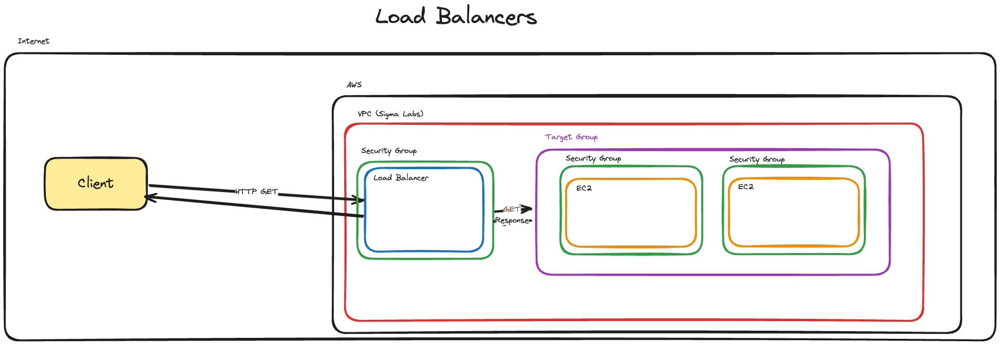

---
objectives:
  [
    'Set up a load-balancer in AWS',
    'Set up a target group in AWS',
    'Redirect traffic to a load-balancer in AWS',
    'Describe the role of a load balancer in the Cloud'
  ]
module: Intro-Cloud
week: 1
workshop: true
---

import LearningObjectiveComponent from '@theme/LearningObjectiveComponent';
import LockedContent from "@theme/LockedContent";

# Load Balancers & Scaling

<LearningObjectiveComponent />

## Prework

### Setup

If it hasn't been done already, copy and paste this command into Slack.

```sh
/prework Load Balancers and Scaling
```

### Watch

:::info Task

Watch the following two videos, taking notes throughout and be prepared to discuss them in the workshop.

<iframe width="560" height="315" src="https://www.youtube.com/embed/sCR3SAVdyCc?si=xwH1w2A8XoC-Gvrc" title="YouTube video player" frameBorder="0" allow="accelerometer; autoplay; clipboard-write; encrypted-media; gyroscope; picture-in-picture; web-share" referrerpolicy="strict-origin-when-cross-origin" allowFullscreen></iframe>

<iframe width="560" height="315" src="https://www.youtube.com/embed/dBmxNsS3BGE?si=qXWJOejG5F5I0MgK" title="YouTube video player" frameBorder="0" allow="accelerometer; autoplay; clipboard-write; encrypted-media; gyroscope; picture-in-picture; web-share" referrerpolicy="strict-origin-when-cross-origin" allowFullscreen></iframe>

Identify any questions that you have about load balancers. Post at least one question in the slack thread.

:::

### Diagram

:::info Task

Using [Excalidraw](https://app.excalidraw.com/) or [Draw.io](https://app.diagrams.net/), create a diagram showing how the following system components are related:

- A load balancer
- A target group
- Several EC2 instances running the same server program
- An external user

Make sure you include any required security groups, subnets, and VPC, as well as connections showing the flow of information.

Post a link to your diagram in the Slack thread.

:::

## Workshop

<LockedContent password="ownership">

### Setup

**Ensure** you have watched the videos in the prework.

**Ensure** you have access to the AWS console.

### Discussion

**Gather** questions from the trainees in a collaborative environment (e.g. Excalidraw)

**Cold call** trainees to answer the following questions:

> 1. What is a load balancer?
> 2. What is the purpose of a load balancer?

**Discuss** the answers to the questions as a group.

### Live Demo

**Explain** that we will be creating a load balancer in AWS using an Application Load Balancer.

**Diagram** out the architecture of the load balancer like the example below. Be sure to include the following components:

> - Load Balancer
> - Target Group
> - EC2 Instances
> - Security Group
>
> 

**Explain** that one of the other key benefits of a load balancer is that you can re-route form one port to another. This is useful for when you have a service running on a port that is not the default port (80 for HTTP, 443 for HTTPS).

**Demonstrate** creating the following cloud infrastructure in the AWS console with the following capabilities:

> - Run a tiny flask application that returns some HTML on the root
>   - You will need to install python and pip using `sudo yum -y install python-pip python3.11`
>     - Remind trainees that `sudo` is only available to them on EC2, not their devices
>   - Running on port 8008
> - Create a load balancer that listens on port 80 and forwards to port 8008
> - Create a target group that listens on port 8008
> - You should highlight:
>   - Health checks
>   - Scaling options
>
> Example code:
>
> ```py
> from flask import Flask
>
> app = Flask(__name__)
>
> @app.route('/')
> def home():
>    html_response = '''
>        <!doctype html>
>        <html lang="en">
>          <head>
>            <meta charset="utf-8">
>            <meta name="viewport" content="width=device-width, initial-scale=1, shrink-to-fit=no">
>            <title>Simple Flask App</title>
>          </head>
>          <body>
>            <div style="text-align: center; margin-top: 50px;">
>              <h1>Welcome to my Flask App!</h1>
>              <p>This is a simple HTML response from a Flask server.</p>
>            </div>
>          </body>
>        </html>
>    '''
>    return html_response, 200
>
> if __name__ == '__main__':
>    app.run(debug=True, port=8008, host="0.0.0.0")
> ```

**Demonstrate** this working by visiting the public DNS address of the load balancer in your browser.

**Discuss** the benefits of load balancers and how they can be used to scale applications.

**Demonstrate** creating a second EC2 instance and adding it to the target group. Ensure you have different HTML on the root of the second instance so that you can tell the difference between them

> ```py
> from flask import Flask
>
> app = Flask(__name__)
>
> @app.route('/')
> def home():
>    html_response = '''
>        <!doctype html>
>        <html lang="en">
>          <head>
>            <meta charset="utf-8">
>            <meta name="viewport" content="width=device-width, initial-scale=1, shrink-to-fit=no">
>            <title>Simple Flask App</title>
>          </head>
>          <body>
>            <div style="text-align: center; margin-top: 50px;">
>              <h1>Welcome to my Flask App!</h1>
>              <h2>This is a different EC2 instance!</h2>
>              <h2>Who am I? Who am I? I am the guardian of lost souls! I am the powerful, the pleasurable, the indestructible Mushu!</h2>
>            </div>
>          </body>
>        </html>
>    '''
>    return html_response, 200
>
> if __name__ == '__main__':
>    app.run(debug=True, port=8008, host="0.0.0.0")
> ```

**Discuss** how the load balancer can be used to distribute traffic between the two instances.

**Demonstrate** the load balancer distributing traffic between the two instances by refreshing the page multiple times and showing the different HTML responses.

### Wrap Up

**Recap** the key points of the workshop.

**Ask** if there are any questions.

</LockedContent>
