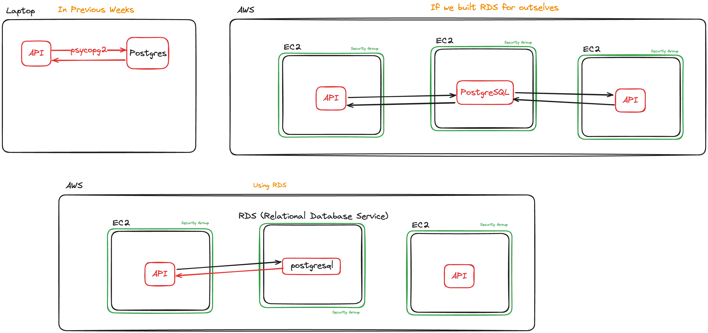

---
objectives:
  [
    'Describe the benefits of using an RDS',
    'Describe what RDS is',
    'Provision an RDS instance',
    'Migrate a local database to AWS',
    'Attach an RDS to an EC2 instance'
  ]
module: Intro-Cloud
week: 1
workshop: true
---

import LearningObjectiveComponent from '@theme/LearningObjectiveComponent'
import LockedContent from "@theme/LockedContent"
import Tabs from '@theme/Tabs'
import TabItem from '@theme/TabItem'

# RDS & Architecture

<LearningObjectiveComponent />

## Prework

If it hasn't been done already, copy and paste this command into Slack.

```sh
/prework RDS and Architecture
```
### Watch

:::info Task

Watch the video below to learn about RDS and its architecture.

<iframe id="border" width="100%" height="315" src="https://www.youtube.com/embed/ylmwaDUMV9c?si=PIhJOJT7Dmczbcxb" title="YouTube video player" frameBorder="0" allow="accelerometer; autoplay; clipboard-write; encrypted-media; gyroscope; picture-in-picture; web-share" referrerpolicy="strict-origin-when-cross-origin" allowFullscreen></iframe>

Identify any questions that you have about RDS. Post at least one question in the Slack thread.

:::

### Diagram

:::info Task

Using [Excalidraw](https://app.excalidraw.com/) or [Draw.io](https://app.diagrams.net/), create a diagram of how an RDS instance on AWS would communicate with

- An EC2 instance also running on AWS
- An external computer outside AWS

Make sure you include any required security groups, subnets, and VPC.

Post a link to your diagram in the Slack thread.

:::

## Workshop

<LockedContent password="ownership">

### Discussion

**Gather** questions from the trainees about the video.

**Discuss** the trainees with the following questions:

> - What is RDS?
> - What are the benefits of using RDS?

**Discuss** some benefits of running PostgreSQL on RDS on AWS.

> - Scalability (can scale up and down)
> - Availability (can be available in multiple AZs)
> - Security (can be secured with IAM)
> - Reliability (can be backed up and restored)

**Ask** the trainee what they think some of the drawbacks of using RDS are.

**Quickly overview** how they have been using a Database so far in the course and how this changes now.

**Highlight** that you could build a database in the cloud using EC2 but this has some drawbacks.



**Ask** the trainees what they think the drawbacks of using an EC2 instance as a database are:

> - You have to manage the database yourself
> - You have to manage the backups yourself
> - You have to manage the scaling yourself
> - You have to manage the security yourself

**Explain** that RDS is a managed service that takes care of all of these things for you.

### Live Demo

**Demonstrate** how to create an RDS instance.

**Explain** each step as you go.

- **Go** to [RDS](https://eu-west-2.console.aws.amazon.com/rds) on AWS
  - Select 'Databases' in the left-hand menu
  - 'Create database' -> 'Full configuration'
- **Select** the following options:
  - 'PostgreSQL'
  - 'Full configuration'
  - 'Free Tier' (or furthest-right equivalent
- **Provide** values for the
  - 'DB instance identifier' (following our established naming conventions)
  - 'Master username' (default `postgres` is fine)
  - 'Master password'
- **Select** the cohort VPC
- **Allow** public access
- **Create** a new security group
- **Disable** 'Performance insights'
- **Leave** anything not mentioned above as a default
- **Create** the database

**Connect** to the RDS instance from your local machine using `psql`, filling in the blanks with your specific values.

```sh
psql -h [DB_URL] -U [DB_USERNAME] -d postgres
```

:::caution

The default rule for a new RDS security group allows access only from the current IP address of the account that creates the resource.

If you want to access the RDS from a different location later, or get the trainees to connect, you'll need to edit the inbound rule to be less exclusionary.

:::

**Live code** the following scripts to set up a new database and connect to it with Python.

<Tabs>
    <TabItem label="setup.sql" value="setup.sql">
  ```sql

DROP DATABASE cakes;
CREATE DATABASE cakes;
\c cakes

CREATE TABLE IF NOT EXISTS cake (
    cake_id INT GENERATED ALWAYS AS IDENTITY,
    flavour TEXT NOT NULL,
    price INT NOT NULL,
    PRIMARY KEY (cake_id)
);

INSERT INTO
    cake (flavour, price)
VALUES
    ('chocolate', 6),
    ('red velvet', 0),
    ('victoria sponge', 3);
  ```
  </TabItem>
  <TabItem label="main.py" value="main.py">
```py
  from psycopg2 import connect
from psycopg2.extras import RealDictCursor

if __name__ == "__main__":

    conn = connect(cursor_factory=RealDictCursor,
               dbname="cakes",
               host="XXXXXXXX",
               password="XXXXXXX",
               user="XXXXXXXX")

    with conn.cursor() as cur:
        cur.execute("SELECT * FROM cake;")
        data = cur.fetchall()

    for row in data:
        print(row["flavour"])
```
  </TabItem>
</Tabs>

**Talk** about environment variables and how they are used to store secrets.

**Explain** that we will use `python-dotenv` to help us to read from `.env`s to keep our secrets safe.

**Walk** through adding the environment variables to the `.env` file.

```sh title=".env"
DB_NAME=cakes
DB_HOST=XXXXXXXXXX
DB_PASSWORD=XXXXXXXXXX
DB_USER=XXXXXXXXXX
```

**Walk** through importing the environment variables into `app.py` using `python-dotenv`.

<Tabs>
  <TabItem label="main.py" value="main.py">
```py title="app.py"
from os import environ as ENV
from dotenv import load_dotenv

...

if __name__ == "__main__":
  load_dotenv()
  conn = connect(cursor_factory=RealDictCursor,
                 dbname=ENV["DB_NAME"],
                 host=ENV["DB_HOST"],
                 password=ENV["DB_PASSWORD"],
                 user=ENV["DB_USER"])
```
</TabItem>
</Tabs>

**Demonstrate** that the code still works as before, but now doesn't contain sensitive values.

**Explain** how important it is to not commit the `.env` file to GitHub. Use the `.gitignore` file to prevent this.

**Recap** the session by asking the trainees

> - What is an RDS?
> - What are the benefits of using an RDS?

</LockedContent>
