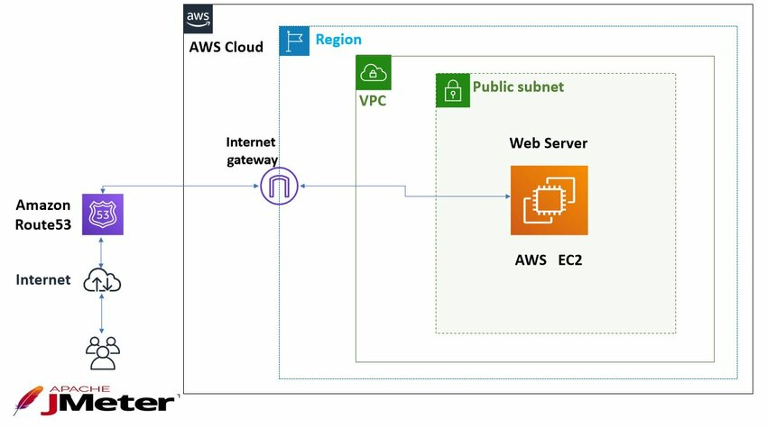
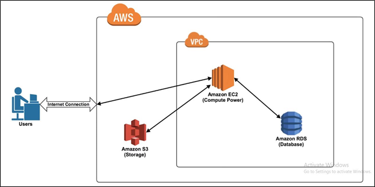

import LearningObjectiveComponent from '@theme/LearningObjectiveComponent';
import LockedContent from "@theme/LockedContent";

<LearningObjectiveComponent />

## Prework

N/A

## Workshop

<LockedContent password="ownership">

### Introduction

**Ask** trainees: "What do you think a systems diagram is for?"

**Explain** that a systems diagram is a visual representation of how different components of a system interact with each other. It helps engineers and stakeholders understand the architecture, identify potential bottlenecks, and communicate ideas effectively.

**Highlight** that systems diagrams are used in planning, troubleshooting, and presenting solutions.

**Split** trainees into pairs or small groups.

**Ask** the trainees to think of a system they are familiar with (e.g. a restaurant, an airport, a music venue).

**Tell** them to diagram in 6 minutes how the system works for a specific user type (e.g. a customer, a traveller, an attendee)

**Bring** the trainees back and share diagrams

**Try** to guess the system.

**Introduce** the key parts of a systems diagram:

1. **Components**: Represented as boxes or icons, these are the individual parts of the system (e.g., servers, databases, APIs).
2. **Connections**: Arrows or lines that show how components interact or communicate.
3. **Labels**: Text that describes the components and connections.
4. **Boundaries**: Dashed or solid lines that group related components (e.g., a VPC or Security Group).

**Explain** that systems diagrams can vary in complexity, from simple block diagrams to detailed architecture diagrams.

**Task** the trainees with thinking of all of the components of an AWS systems architecture diagram.

> - EC2
> - S3
> - RDS
> - Scaling Groups
> - VPC
> - IAM
> - Security Groups
> - Load Balancers
>   etc

**Task** the trainees to also think about the complexity behind each component

> - EC2: Instance types, AMIs, EBS volumes
> - S3: Buckets, policies, lifecycle rules
> - RDS: Instance types, _read replicas_, _backups_
> - Scaling Groups: Policies, health checks
> - VPC: _Subnets_, route tables, _NAT gateways_
> - IAM: _Roles_, policies, _permissions_
> - Security Groups: Inbound/outbound rules
> - Load Balancers: Target groups, listeners, health checks

**Explain** that the complexity of each component can be represented in the diagram, but it is not always necessary to include every detail.

**Introduce** the concept of **abstraction** in systems diagrams. Abstraction allows you to simplify complex systems by focusing on the most important components and their interactions.

**Highlight** the part of the above areas that should be on a systems diagram. (Highlighted in italics above).

**Share** an example of a simple AWS diagram:

**Share** an example of a slightly more complex AWS diagram:

**Scare** the trainees by showing them a very complex diagram:

**Give** the trainees 10 minutes to create a systems diagram of a restaurant's payment system.

> - **Components**: Point of Sale (POS) system, payment processor, databases, servers
> - **Connections**: Arrows showing data flow between components (e.g., user input to POS, POS to payment processor)
> - **Labels**: Descriptions of components and connections (e.g., "User Input", "Payment Processing")
> - **Boundaries**: Group related components (e.g., "Payment System" boundary around POS and payment processor)

**Remind** them to consider horizontal and vertical scaling in their decisions.

**Share** the diagrams with each other on excalidraw. Highlight the differences in the diagrams.

**Ask** trainees to explain their design choices:

- Why did they place components in certain locations?
- Why did they group certain components together?
- How does their design ensure security and scalability?
- What are the technical reasons for choosing this architecture? (e.g., performance, cost, security, reliability)

**Encourage** peer feedback and discussion to refine the diagrams, focus on how the process is often iterative and collaborative. It's very very unlikely that an architecture diagram will be the same at the start as it is at the end of a project.

### Wrap-Up

**Recap** the key points:

- Systems diagrams are essential for planning and communication.
- The key parts of a diagram are components, connections, labels, and boundaries.
- Justifying design decisions helps ensure the diagram meets the system's requirements.
- Technical reasoning is crucial for effective architecture.

**Encourage** trainees to practice creating diagrams for more complex systems as they progress through the course.

</LockedContent>
