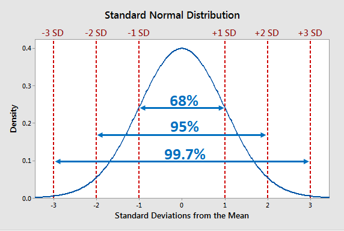

import Tabs from '@theme/Tabs';
import TabItem from '@theme/TabItem';
import LearningObjectiveComponent from '@theme/LearningObjectiveComponent'
import LockedContent from "@theme/LockedContent";

<LearningObjectiveComponent />

## Pre work

### Set up

If nobody has done so already, copy and paste this command into Slack.

```
/prework Anomaly Detection
```

### Task

:::info Task

Using your `cleaned_regional_data.csv` from the Pandas workshop (or by downloading a clean copy [here](https://sigma-resources-public.s3.eu-west-2.amazonaws.com/daf-workshops/cleaned_regional_data.csv)), answer the following questions in the Slack thread:
 
1. What are the highest and lowest ticket prices in the dataset?
2. What is the average number of tickets sold per sale?
3. How many rows are in the data?
4. What is the _second_ most popular event category name by number of sales?

:::

## Workshop

<LockedContent password="ownership">

**Elicit** questions about the prework

**Present** the following problem

> One member of the Box Office team has flagged some concerns about the regional `ticket` data we've been working with in our Pandas workshop.
> Before we use it for any meaningful analysis,
> we need to check it for anomalies — strange values, impossible numbers,
> suspicious patterns.
>
> She's asked us to look through the event and sales data and identify
> anything that doesn't look right. Only once we're confident in the data
> can we trust the insights we draw from it.
 
**Define** what an anomaly is in data

> An anomaly is an instance or collection of data points whose features differ significantly
> from most of the data
>
> In simpler terms, it is data that is wildly different from the rest of the dataset

**Ask** trainees why detecting and removing anomalies is important

> Anomalies will skew the dataset and reduce the accuracy of the insights we
> draw from the data
>
> For example, if we have a list `[1, 2, 4, 2, 1, 4, 5, 3, 1, 10000000]`
> The average of this would be `1000002` and is clearly not
> representational of the dataset. However, by ignoring the `outlier`,
> the average becomes ~`2.56`, which feels more accurate for the
> majority of the data.

**Load** the events data using `pandas`

```py
import pandas as pd
import altair as alt

alt.data_transformers.enable("vegafusion")

events = pd.read_csv("cleaned_regional_data.csv")
events.info()
```


**Highlight** the column names and types — most of the sales-related columns are numerical, which is what we need for statistical anomaly detection.
 
**Point out** that the data is already cleaned (from the Pandas workshop), but cleaned data can still contain **statistical anomalies** — values that are mathematically possible but don't make business sense.


**Point out** that there is a more useful method to learn more about numerical columns

```py
events.describe()
```

**Talk through** the various information available

> - **count**: the number of non-null values
> - **mean**: the average of the values
> - **std**: the standard deviation (meaning the average amount of difference from the mean)
> - **min**: the minimum value
> - **25%**: the first quartile
> - **50%**: the second quartile
> - **75%**: the third quartile
> - **max**: the maximum value

**Explain** that all of these values are useful for finding erroneous data.

**Ask** trainees what looks suspicious in the `.describe()` output

> Possible issues to spot:
> - Is the minimum `pricepaid` and `qtysold` reasonable? (should be >= 0)
> - Is the maximum `pricepaid` reasonable? (extreme outliers?)
> - Is there a massive gap between the 75th percentile and the max for any column?


### Range-based Filtering

**Start** to clean the data.

 
> Ticket prices should be positive. A price of 0 means no sale happened, but negative prices shouldn't exist. Similarly, qtysold should never be negative.


```py
# Filter out any rows with negative ticket prices
events = events[events["pricepaid"] >= 0]
events = events[events["qtysold"] >= 0]

events.describe()
```

### Derived Columns for Deeper Analysis

**Explain** that creating new columns can help surface anomalies that aren't visible in the raw data.

> Let's calculate the price per ticket for each sale to see if anything looks off.


```py
# Avoid division by zero
sales = events[events["qtysold"] > 0].copy()
sales["price_per_ticket"] = sales["pricepaid"] / sales["qtysold"]
sales["price_per_ticket"].describe()
```

**Ask** trainees: are there any events with suspiciously high ticket prices?
 
**Discuss** whether these are real outliers or just premium events — this is a judgement call. 
In this case, choose 1000 as the upper limit to account for VIP/Charitable events and amend the values using range.

```py
sales = sales[(sales['price_per_ticket'] >= 0) & (sales['price_per_ticket'] <= 1000)]
sales["price_per_ticket"].describe()
```
 
 
**Ask** trainees: does anything jump out? Are there ticket prices that seem impossibly high or low?
 


### Visual Anomaly Detection
 
**Shift** focus to visual methods of anomaly detection.
 
**Live code** a box and whiskers chart to find outliers in ticket prices by `catname`.
 

```py
alt.Chart(sales).mark_boxplot().encode(
    y="catname:N",
    x="price_per_ticket:Q",
    tooltip=["eventname:N", "catname:N", "price_per_ticket:Q"]
).properties(
    width=1000,
    height=200,
    title="Price per Ticket by Event Category")
```

**Point out** that some categories may have a much wider spread than others.
 
**Discuss** whether the outliers are genuine premium events or data errors — this is the core skill of anomaly detection.
 
**Ask** the trainees their opinion of whether or not to remove them

> There is only one ticket sold at 1000 and whilst it *was* for an opera production it appears to be an outlier as it is unlikely that it was part of a larger, pricier event. 

**Adjust** our filter on `price_per_ticket` to remove the 1000 entirely and re-render the chart.

```py
sales = sales[(sales['price_per_ticket'] >= 0) &
              (sales['price_per_ticket'] < 1000)].copy()
```

  
**Discuss** with trainees whether the remaining outliers here are concerning or expected.

> The outliers at the higher price levels are all Christmas-based shows, or "Evita". These might indicate high pricing surges due to the time of year, or the popularity of a specific production.
>
> The outliers at a lower level should be investigated further, as they still look far too low, and some are still coming in with a `price_per_ticket` level of 0!
 
### Statistical Anomaly Detection: Z-Scores


**Introduce** the concept of z-scores

> To find outliers in a dataset, we can use _standard deviation_. Standard deviation is a measure of how spread out or
> close together the data is to each other. The closer the data is to each other, the lower the standard deviation.
> In a dataset, we describe a standard deviation as a unit and measures in _n number of deviations_
>
> In a standard normal distribution (a bell curve), around 68% of the data lies within one standard deviation,
> or a `z-score` (the number of standard deviations away from the mean a datapoint is) of +/- 1, from the mean, and about 95% within two standard deviations (z-score of +/- 2).
> Approximately 99.7% of data points fall within three standard deviations (z-score of +/-3) from the mean,
> often referred to as the "68-95-99.7 rule" or the "empirical rule."
>
> 
>
> _In plain English_, this means that 99.7% of all the data should be within 3 standard deviations from the average.
> By removing all data points beyond this, we can remove most, if not all of the outliers in the data. One
> caveat is that if more than 0.3% of the data are outliers, they will remain.

**Add** the import for zscore from the `scipy.stats` library as well as numpy

```py
from scipy.stats import zscore
import numpy as np
```

**Calculate** the z-score for `price_per_ticket`

```py
sales["price_zscore"] = zscore(sales["price_per_ticket"])
```
 
**Set** the threshold for the z-score to 3 to remove outliers
 
```py
z_threshold = 3
```
 
**Filter** the outliers by using the _absolute value_ of the z-score:
 
```py
clean_sales = sales[sales["price_zscore"].abs() < z_threshold].copy()
```

> Notice that after z-score filtering, _Evita_, _The Nutcracker_ and _A Christmas Carol_ are still present. 
> They weren't removed because their prices fit a real distribution—they're not errors, 
> they're just expensive events. The question now becomes: why?

### Anomaly Detection: Relationship Patterns

**Explain** that some anomalies only appear when you look at _multiple_ variables together.

> So far, we've looked at individual columns in isolation. But sometimes the anomaly
> isn't in a single value—it's in the _relationship_ between values.
>
> For example, a £0 price might be normal for a small amount of tickets given away. But £0 price 
> combined with a _large_ quantity sold (300+ tickets) is suspicious—that suggests 
> something unusual happened (preview night, cancelled event, or data error).

**Live code** a scatter plot showing the relationship between price and quantity:

```py
alt.Chart(clean_sales).mark_circle().encode(
    x="price_per_ticket:Q",
    y="qtysold:Q",
    color="catname:N",
    tooltip=["eventname:N", "catname:N", "price_per_ticket:Q", "qtysold:Q"]
).properties(
    width=800,
    height=400,
    title="Price per Ticket vs Quantity Sold"
)
```

**Point out** the patterns visible here that weren't as obvious in the box plots.

> - **Top-right cluster**: _Evita_ and _Christmas Carol_ with both high prices AND high quantities, these are likely legitimate premium events.
> - **Bottom band**: Some points with £0 prices but varying quantities—this is suspicious and needs investigation
> - **General pattern**: Most events cluster in the middle area, showing typical pricing and quantities

**Task** trainees to investigate the £0 price rows:

> Filter `clean_sales` for rows where `pricepaid == 0` and examine them. 
> What events have free tickets? Are these legitimate business scenarios (like free previews or press nights)
> or data quality issues that should be removed?
```py
free_tickets = clean_sales[clean_sales["pricepaid"] == 0]
free_tickets[["eventname", "catname", "qtysold", "pricepaid"]]
```

**Discuss** the patterns that emerge:

> - All £0 tickets are for major musicals and premium events
> - Quantities sold are substantial (270-671 tickets), not tiny quantities
> - This suggests **preview nights, press previews, or complimentary performances** rather than data errors
> - These are **legitimate business scenarios** worth investigating further

### Event-Level Anomalies: Understanding Premium Pricing

**Explain** that the Evita, Nutcracker, and Christmas anomalies deserve deeper investigation.

> We've identified that these events consistently have high prices. Before deciding whether 
> to keep or remove them, we should understand _why_. Are they intentionally priced higher?
> Is there a business reason? Or is there a data quality issue?

#### Which events have the highest average prices?
```py 
mean_prices = clean_sales.groupby("eventname")["price_per_ticket"].mean()
counts = clean_sales.groupby("eventname").size()
event_stats = pd.DataFrame({'mean': mean_prices, 'count': counts}).sort_values('mean', ascending=False)
print(event_stats.head(10))
```

**Discuss** the findings:

> - **Evita**, **The Nutcracker**, and **A Christmas Carol** consistently have the highest average prices
> - These premium events maintain high prices across all seasons
> - This strongly suggests intentional pricing strategy, not a data error
> - The Nutcracker's pricing is particularly consistent (a controlled, seasonal event)
> - Question: Is this a legitimate business decision (premium events, holiday pricing) or an anomaly worth removing?

**Extend** the investigation: Venue and seasonal patterns.

```py
# Create season column and investigate
clean_sales["starttime"] = pd.to_datetime(clean_sales["starttime"])
clean_sales["month"] = clean_sales["starttime"].dt.month
clean_sales["season"] = clean_sales["month"].apply(
    lambda m: "Winter" if m in [12, 1, 2]
    else "Spring" if m in [3, 4, 5]
    else "Summer" if m in [6, 7, 8]
    else "Fall")

# Focus on the identified premium events: are they expensive year-round or seasonal?
top_events = ["Evita", "A Christmas Carol", "The Nutcracker"]
premium_seasonal = clean_sales[clean_sales["eventname"].isin(top_events)]
print(premium_seasonal.groupby(["eventname", "season"])["price_per_ticket"].mean())
```

**Conclude** the investigation

> The key anomaly detection skill isn't just finding outliers—it's **understanding them**. 
> Evita and Christmas Carol are anomalies in price, but they may be legitimate business anomalies 
> (premium events with intentional higher pricing) rather than data errors. 
> Your job as an analyst is to investigate, gather evidence, and communicate findings to stakeholders 
> to determine whether to keep, adjust, or remove them from analysis.

### Final task: Investigate the £0 prices

**Task** trainees to dig deeper into the £0 price anomaly:

> Now that you've learned multiple anomaly detection methods, apply them to understand the £0 price phenomenon:
> Are these all legitimate business decisions, or do you find any that should be removed from analysis?
> Use the `cancelled` column to help investigate.

```py
# How many of the £0 price rows are from cancelled events?
free_cancelled = free_tickets[free_tickets["cancelled"] == 1]
free_legitimate = free_tickets[free_tickets["cancelled"] == 0]

print(f"Total £0 price rows: {len(free_tickets)}")
print(f"Cancelled events (£0): {len(free_cancelled)}")
print(f"Legitimate previews (£0): {len(free_legitimate)}")
print("\nCancelled events with £0 price:")
print(free_cancelled[["eventname", "qtysold", "cancelled"]])
```

**Discuss** the findings:

> - **Cancelled events** (11 rows): These £0 prices represent performances that never happened. They should likely be removed from analysis as they don't reflect real business transactions
> - **Legitimate previews** (37 rows): These are intentional business decisions to offer free preview performances. They should stay in the dataset to represent the full picture of ticket activity
> - **Key lesson**: An anomaly isn't always an error. Context (the `cancelled` column) completely changes the interpretation
> - **Final takeaway**: This illustrates the most important principle in anomaly detection—**investigate before you decide**. Context changes everything.

</LockedContent>