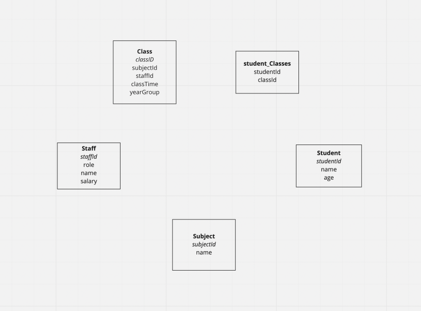

---
objectives:
  [
    'Use `psql` to communicate with a PostgreSQL database',
    'Write `SQL` scripts that are idempotent',
    'Connect to and query from a database from an API'
  ]
module: SF-Backend
week: 2
workshop: true
---

import LearningObjectiveComponent from '@theme/LearningObjectiveComponent'
import LockedContent from "@theme/LockedContent";
import Tabs from '@theme/Tabs';
import TabItem from '@theme/TabItem';
import EmbeddedYoutubeVideo from '@theme/EmbeddedYoutubeVideo';

# Modelling Databases

<LearningObjectiveComponent />

## Pre-work

### Watch

Throughout this week, we'll be working with relational databases.

:::info Task

Watch the below video on relational databases.

<EmbeddedYoutubeVideo id="OqjJjpjDRLc" />
:::

### Read

The language used to communicate with relational databases is known as SQL.

:::info Task

Complete section 1 of the [SQL tutorial](https://www.sqltutorial.org/).

:::

### Explore

:::info Task

Complete the following introductory SQL challenges from [SQL ZOO](https://sqlzoo.net).

- [SELECT Basics](https://sqlzoo.net/wiki/SELECT_basics)
- [`SELECT FROM world`](https://sqlzoo.net/wiki/SELECT_from_WORLD_Tutorial)

:::

## Workshop

<LockedContent password="ownership">

**Elicit** questions from the trainees about the prework. You do not need to answer all of them right now.

### Motivate

**Remind** trainees of how they've stored data in previous weeks: in memory, in raw text, and in JSON format.

**Stress** that these methods are acceptable for small amounts of simple data, but as our datasets grow and represent more complex relationships, it becomes inefficient to handle them like this. What we need is a scalable solution that allows us to write complex queries.

**Introduce** the idea of a **database**: a structured store for data.

### Relational Databases

**Explain** that we will be using a _relational database_, and that we will be using _SQL_ to interact with it.

**Explain** that the database software we are using is called PostgreSQL (sometimes called Postgres). The language we use to interact with it is a dialect of SQL.

**Ask** the trainees what the drawbacks of storing data in different formats is

> - In Memory (_Data is lost when the program stops running_)
> - In a File: (_Hard when you have lots of data, and hard to share between programs_)

**Explain** that databases are a way to store data on disk and provide an interface for reading and writing that data.

**Ask** the trainees to explain the key benefits of doing this:

> - Data is persistent
> - Data can be shared between multiple programs
> - Data can be stored in large quantities
> - Data can be queried in a structured way
> - Very large amounts of data can be stored
> - Data can be queried very very quickly

**Explain** that designing databases is about entities and relationships.

**Ask** "What is an entity?"

> Entities can be people, places, events, objects, concepts…

**Ask** "What is an attribute?"

> Attributes describe the characteristics or properties of an entity

**Explain** that, in databases, entities are our tables - if you can’t make a table or it doesn’t have a relationship with another entity, it is probably an attribute.

### Demo

**Ask** the trainees to share ideas for what you can make a database to store the data of (the more fantastical the better)

**Prompt** the trainees list the attributes of one of the entities within the database

**Sketch** out a **single** table of the database with all of the columns that the trainees suggest. Put all of the attributes in a single column.

**Ensure** you make this a bad database. Use lists of data in columns, don’t use relationships, don't use multiple tables, duplicate data between rows.

**Ask** the trainees what is wrong with this database.

> - Data duplication
> - Data inconsistency
> - Data redundancy
> - Lists are bad in databases

**Sketch** out how we can fix this by splitting any duplicated data into a separate table and linking the two tables together.

**Explain** that this is called normalisation.

**Sketch** out that we can remove the need for lists by moving each list item into it's own row in a separate table and linking the two tables together using a joining table

### Relationship Types

**Explain** that there are three types of relationships in databases

> - One to one relationships (e.g. User and Profile)
> - One to many relationships (e.g. Author to Books, Street to Houses)
> - Many to many relationships (e.g. Doctors and Patients)

**Copy** the below diagram into a whiteboarding tool



**Ask** the trainees "What kind of relationships might our example have?"

> - One to one relationships
> - One to many relationships
> - Many to many relationships

**Gather** opinions and answers then reflect on them

**Draw** the relationships out on the diagram above

### Intro: PSQL

**Explain** that we will be using PSQL to interact with our database.

**Ask** the trainees what they think PSQL is:

> PSQL is a command line tool that allows us to interact with our database.

**Demonstrate** how to connect to a database using PSQL

```bash
psql postgres
```

**Explain** that this connects to the database called `postgres`, which is the default database

**Explain** you can run SQL files using PSQL

```bash
psql -f file.sql
```

**Tell** the trainees to begin on Challenge 1a and that it is important they:

> - Follow along using PSQL
> - Only gain a surface level understanding, they'll do loads of SQL this week
> - Spend no more than a couple of hours on it

### Recap

**Recap** what the trainees have learned today.

</LockedContent>
