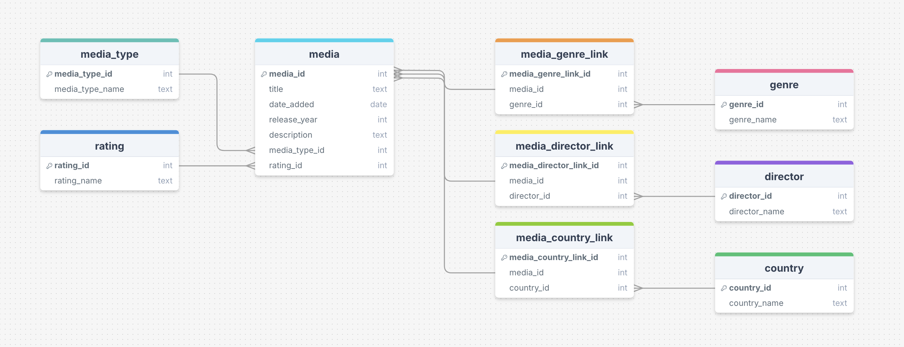

import LearningObjectiveComponent from '@theme/LearningObjectiveComponent'
import LockedContent from "@theme/LockedContent";

<LearningObjectiveComponent />

## Pre-work

### Database creation

:::info Task

Download and run the [setup_streaming_db](https://sigma-resources-public.s3.eu-west-2.amazonaws.com/software-fundamentals/setup_streaming_db.sql) script.

Check that you can connect to this database using `psql`.

:::

### Exploration

:::info Task

Examine the below ERD carefully; how do the different tables connect? What does each table contain?

:::



## Workshop

<LockedContent password="ownership">

### Database setup

**Download** the `setup_streaming_db.sql` [file](https://sigma-resources-public.s3.eu-west-2.amazonaws.com/software-fundamentals/setup_streaming_db.sql).

**Show** trainees the `setup_streaming_db.sql` file and the [streaming_erd](./assets/streaming_erd.png); talk through the general structure.

**Explain** that `psql` can be used to run commands from a `.sql` file.

> `psql postgres -f setup_streaming_db.sql`

**Explain** that this has created a new database on your local machine.

**Get** trainees to walk you through the process of connecting to the new database and exploring the basic structure.

> `psql streaming`

> `\dt`

> `SELECT * FROM country;`

### Syntax

**Ask** trainees how you would see just the titles of all media.

> SELECT title FROM media;

**Complicate** the query steadily, adding new syntax as appropriate.

**Encourage** the trainees to guide you and explain the syntax as you write it.

**Include**

- `WHERE` to filter results
- `ORDER BY` to change the order of displayed rules
- `LIMIT` to display only a certain number of results
- `MIN()` and `MAX()` to aggregate results
- `||` as the concatenation operator

**Highlight** to trainees that these key words can be combined together to produce complex behaviour, but that the order of keywords is fixed. `WHERE` comes after `FROM`, and `LIMIT` is always at the end.

### Challenge

**Challenge** trainees to write queries for the following:

1. The number of movies have the word 'love' in the title
2. The number of shows have the word 'romance' in the description
3. The first five movies in the database, displayed as `Title (year of release)`

### Joins

**Introduce** the `JOIN` keyword as a way to combine tables together

```sql
SELECT title, media_type
FROM media AS M
LEFT JOIN media_type AS MT
  ON (M.media_type_id = MT.media_type_id)
;
```

**Demonstrate** that this allows you to access data from both tables, matched across by 

**Stress** that, like all SQL keywords, `JOIN` is compositional; multiple tables can be `JOIN`ed together simply by stacking the keyword.

```sql
SELECT title, media_type
FROM media
LEFT JOIN media_type
  USING (media_type_id)
LEFT JOIN rating
  USING (rating_id)
;
```

### Challenge

**Divide** the trainees into pairs.

**Challenge** them to find answers to the following questions:

1. How many movies were made in 2019?
2. What's the earliest a TV show about vampires was added to the service?
3. How many directors have an A in their first name?
4. How many movies were added to the service in the same year they were released? 
5. How many shows available in the US have a director with the first name of John?

**Gather** trainees back together and discuss solutions.

```
-- 1. How many movies were made in 2019?

SELECT COUNT(*)
FROM media as M
JOIN media_type as MT ON M.media_type_id = MT.media_type_id
WHERE MT.media_type_name = 'movie' AND M.release_year = 2019;


-- 2. What's the earliest a TV show about vampires was added to the service?

SELECT MIN(M.date_added)
FROM media as M
JOIN media_type as MT ON M.media_type_id = MT.media_type_id
WHERE MT.media_type_name = 'show' AND M.description ILIKE '%vampire%';


-- 3. How many directors have an A in their first name?

SELECT COUNT(DISTINCT D.director_id)
FROM director as D
WHERE SPLIT_PART(D.director_name, ' ', 1) ILIKE '%a%';


-- 4. How many movies were added to the service in the same year they were released?

SELECT COUNT(*)
FROM media as M
JOIN media_type as MT ON M.media_type_id = MT.media_type_id
WHERE MT.media_type_name = 'movie' AND EXTRACT(YEAR FROM M.date_added) = M.release_year;


-- 5. How many shows available in the US have a director with the first name of John?

SELECT COUNT(DISTINCT M.media_id)
FROM media as M
JOIN media_type as MT ON M.media_type_id = MT.media_type_id
JOIN media_country_link as MCL ON M.media_id = MCL.media_id
JOIN country as C ON MCL.country_id = C.country_id
JOIN media_director_link as MDL ON M.media_id = MDL.media_id
JOIN director as D ON MDL.director_id = D.director_id
WHERE MT.media_type_name = 'show' 
  AND C.country_name = 'United States'
  AND SPLIT_PART(D.director_name, ' ', 1) ILIKE 'john';
```

</LockedContent>
