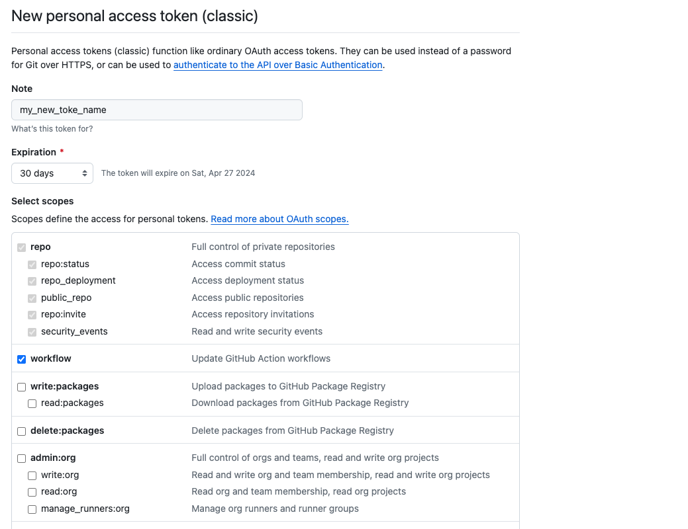

# Challenge 0: Getting Setup

## Before you start

Before jumping into our first project, we'll need to make sure that you have completed all of the setup steps.

Please read and complete the steps in the [Getting Setup](https://coda.io/d/Trainees_dryBdidTdcn/Getting-Setup_suXgoRUP) guide.

It's important that you've got all of the software installed that we require before continuing.

## 1. Cloning The Coursework Repo

:::info Task

To get started you'll want to fork and clone the coursework repo so that you can work on the materials more easily.

Every week of the course has its own coursework repository so you'll have to do this every week.

1. Fork this repo on Github
   - [https://github.com/Sigma-Labs-XYZ/Coursework-Fundamentals-Week-1](https://github.com/Sigma-Labs-XYZ/Coursework-Fundamentals-Week-1)
2. Clone the repository to your Laptop
3. When prompted for a password, you'll need to generate a Personal Access Token (PAT) to use instead of a password. You should follow the instructions [here](https://docs.github.com/en/authentication/keeping-your-account-and-data-secure/creating-a-personal-access-token).
   - When you create your PAT, you **must** enable 'Workflows'. This lets us run tests on your code when you push them to GitHub.
   
4. Enter your username and PAT as the password
5. Open the cloned repo in VSCode

:::

## 2. Create a venv

We're going to be using a 'virtual environment' to manage our dependencies. This is a good practice to get into as it means that we can have different versions of the same package installed on our machine without them conflicting.

If this is your first time using a virtual environment, then watch the first three minutes of this video [here](https://www.youtube.com/watch?v=KxvKCSwlUv8).

:::info Task

1. Open a terminal in VSCode
2. Run the command `python3 -m venv .venv`
3. Run the command `source .venv/bin/activate` to activate the virtual environment

:::

## 3. Install the dependencies

We're going to be using `pytest` to run our tests. This is a popular testing framework for Python.

:::info Task

1. Run the command `pip3 install -r requirements.txt`
2. Run the command `pytest` to check that everything is working

:::
