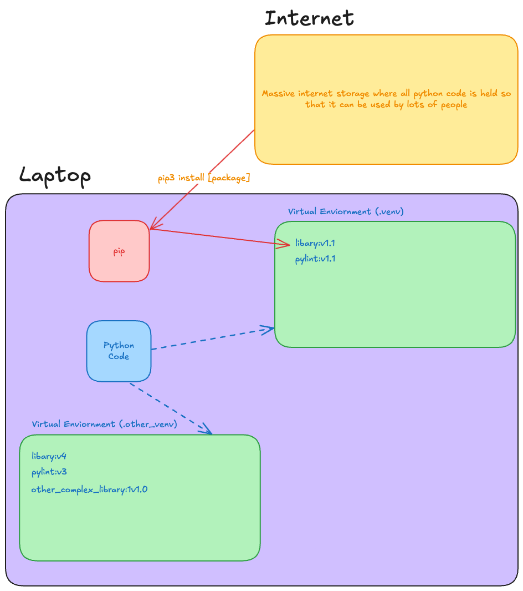

import LockedContent from "@theme/LockedContent";

# Introduction

:::tip Learning Objectives

By the end of this workshop you should be able to:

- Clone a Git repository
- Add and remove files to the staging area
- Create commits with meaningful commit messages
- Create branches and pull or push branches to a remote repository
- Use the `git status` and `git log` commands to understand the current state of their working repo
- Use Slack effectively

:::

## Pre-work

No prework required for this workshop as it's the first of the course.

## Workshop

<LockedContent password="dayone">

**Explain** that there are a few key aims for the rest of the day

> 1. Ensure everyone knows how to use Slack & SigmaBot
> 2. Ensure everyone knows how to use Git
> 3. Ensure everyone knows how to use the coursework repositories
> 4. Ensure everyone can write some Python code
> 5. Write a little code, to build something fun by the end of the day!

### Slack

**Explain** what Slack is and what it is trying to achieve

**Explain** the main aims of Slack

> - To reduce the amount of emails sent
> - To reduce the amount of meetings
> - To increase the amount of communication between teams and team members

**Explain** the difference between `@ChrisOwen`, `@trainees`, `@here` and `@channel`

**Show** that if you message in a thread it will only notify the people in that thread

**Reinforce** that fact that messages should always be in **threads**

**Explain** how messages on Slack should always prioritise the reader rather than the sender. This means that messages should be formatted in a way that is easy to read and understand, good spelling and grammar.

**Reinforce** that not doing the above is a sign of disrespect to the reader. You are forcing them to do more work to understand you.

**Explain** how to format messages using ``` to format code

**Explain** that you can respond to general messages with an emoji to show engagement, but stress that messages sent to you directly warrant a full written response.

**Explain** that you should use the correct channel for the right task

> - Questions channel for questions
> - General channel for general chat
> - Random channel for random chat
> - Career channel for everything individual (e.g. holiday, sick, etc.) and for any career related

**Reiterate** you should not message people directly unless you have a good reason to do so

> - It's very personal
> - It's very disruptive

**Explain** that when messaging a coach you are often going to be one of many to ask. If the coach replies to each person individually it will take too long. You are being a good team player if you ask questions publicly.

**Explain** that you should use Huddles for quick meetings

**Demonstrate** how to use Huddles quickly

> - Show that you can share your screen
> - Show that you can share your camera
> - Show that you can share your microphone

**Show** that anyone can change the settings of Slack, including changing the theme, emojis etc

**Lightly** suggest that adding some emojis to the workspace is a good idea

**Remind** trainees that emoji reactions to show engagement are a positive signal

**Warn** that, if someone has sent you a long, detailed message, an emoji reaction may read as dismissive

### Sigma Bot

**Explain** that SigmaBot is a bot that can help you with questions

**Demonstrate** how to use SigmaBot

> - Ask a question
> - Do common actions (e.g. prework, quiz, group code review)

### Working with Repos

**Explain** the process of doing coursework at Sigma Labs

> - Fork the coursework repository
> - Clone the coursework repository
> - Enable Github Actions for the coursework repository
> - Commit your code to your fork

**Show** the trainees the following repository that they'll be using today

> https://github.com/Sigma-Labs-XYZ/Coursework-Fundamentals-Day-1

**Step Through** the process of using Git, cold calling trainees for each step

> - Clone a repository
> - Enable Github Actions for the coursework repository
> - Add files to the staging area
> - Commit files with a meaningful commit message

**Show** how you can use `git status` and `git log` to understand the current state of their working repo

**Tell** the trainees to follow the instructions in [Getting Started](../01-Getting-Setup.md) to clone the coursework repository.

**Help** the trainee through this process.

**Explain** that when working with the coursework repositories, they will have some fancy Code Quality automations happening

**Demonstrate** that if we push our code to the repository, wait for a moment, then it will run some checks on our code

**Demonstrate** (after waiting two minutes) again trying to push another change to github. This time it will fail because there is an outstanding commit that hasn't been pulled.

### Intro to VSCode

**Explain** that VSCode is a code editor that we will be using for the rest of the course

**Show** how to open a the repository folder in VSCode

**Explain** that to be able run code they're going to need to be inside something called a virtual environment

## Dependencies

**Explain** that fairly often we want to rely on code that other people have written, rather than writing it ourselves

**Explain** that this is done by installing dependencies, which are packages of code that can be used in our own code

**Explain** that Python has a package manager called `pip` that can be used to install dependencies

**Explain** that we will be using a file called `requirements.txt` to specify the dependencies that we want to install

**Show** the trainees how to open the `requirements.txt` file and add a dependency to it

**Explain** that we can then run `pip3 install -r requirements.txt` to install the dependencies

**Shocked** show that the dependencies don't get installed because we haven't created a virtual environment yet!

### Virtual Environments

**Explain** that a virtual environment is a way to create an isolated environment for Python projects

**Diagram** out something like the below to show how we can use `pip3` to install dependencies in a virtual environment



**Diagram** out the virtual environment process

> - Create a virtual environment
> - Activate the virtual environment
> - Install dependencies
> - Run code

**Live code** the process of creating a virtual environment, activating it, and installing dependencies

```bash
python3 -m venv .venv
source .venv/bin/activate
pip3 install -r requirements.txt
```

**Explain** that the virtual environment is now active, and we can run our code

> `python3 setup/check_install.py`

### Building something fun!

**Explain** that for the rest of the day we're going to be building something fun - we're going to playing with a Turtle

**Explain** that `turtle` is a simple graphics library that allows us to draw shapes and patterns

**Explain** that we'll need one more library to help us here

> brew install python-tk

**Run** the code in the repository to show the Turtle in action

> python3 drawing/draw.py

**Celebrate** as the Turtle draws a shape

**Run** briefly through the code in `drawing/draw.py`, showing the existing functions.

**Ask** the trainees how Turtle works...expecting them to be a bit confused.

**Explain** that there is no way we can work this out from here - we need to use the documentation.

> https://docs.python.org/3/library/turtle.html

**Direct** trainees's attention to `drawing/challenges.md`.

**Instruct** them to work their way through the challenges, focusing on clean, readable code as they go.

**Circulate**, supporting and assessing trainee skill levels as you do so. **Fix** any config issues.
> - (OPTIONAL) **Show** them [this relevant xkcd comic](https://xkcd.com/1029/) when they start trying to draw stars 

**Encourage** trainees to share the results of the final challenge on Slack.

</LockedContent>
