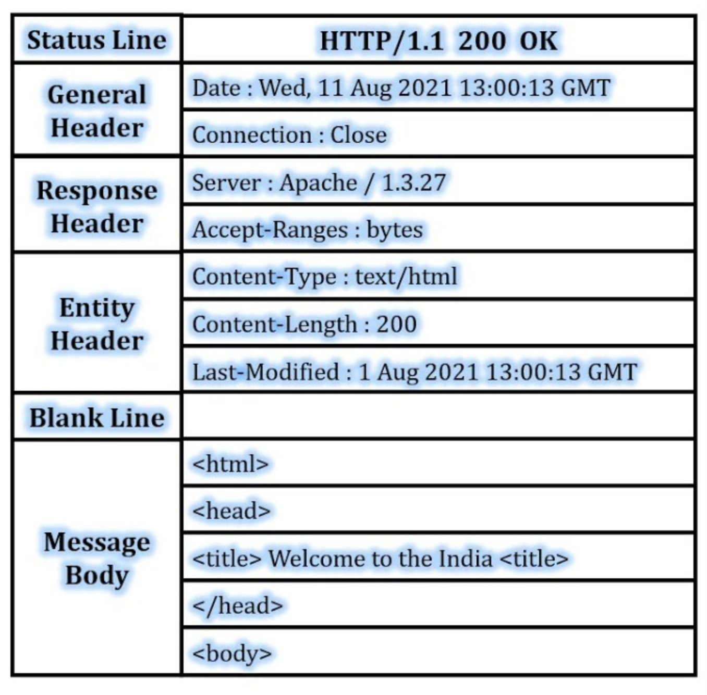

---
objectives:
  [
    'Describe a situation when you would use a POST request',
    'Use `request` to send a POST request to an API using Python'
  ]
module: Networking
week: 1
workshop: true
---

import LearningObjectiveComponent from '@theme/LearningObjectiveComponent'
import LockedContent from "@theme/LockedContent"

# Posting Data

<LearningObjectiveComponent/>

## Pre-work

### Setup

If nobody has already, copy and paste this command into Slack

```
/prework POST Requests
```

### Recap

In today's workshop we'll be learning about how to create a POST request to send data to an API. As a quick recap, try to recall what each of the following HTTP Methods should be used for.

:::info Task

Write a sentence for each of the methods below explaining what they are for:

- GET
- POST
- PUT
- DELETE
- PATCH
- HEAD

:::

### Review

:::info Task

We'll be using this API in today's workshop. Familiarise yourself with the endpoints that make up the following API:

[https://tools.sigmalabs.co.uk/api/microblogs/docs](https://tools.sigmalabs.co.uk/api/microblogs/docs)

:::

### Predict

:::info Task

Consider the below snippet of code. 

```py
payload = {
  "order_id": 12345,
  "status": "paid"
}

res = requests.post("https://api.example.com/update-order",
                    json=payload)
```

Answer the following questions:

1. In practical terms, what does this code do?
2. What would you expect `res` to contain?
3. What would be the expected effect on the server of running this code?

:::

## Workshop

<LockedContent password="ownership">

**Setup** before the workshop starts ensure that the Microblogging API is up and running. This is hosted on Heroku. Speak to Chris or Dan to launch it.

**Elicit** questions from trainees about the prework.

**Explain** that up until this point we've only been _requesting_ data from the internet but when we use the internet (e.g. to book a hotel, to order food, to send a message to a friend) we need to ask be able to send information as well

**Explain** the different parts of a HTTP Request:



**Demonstrate** using the Network Tab on Chrome how you can see this information in real time when we visit websites. Demonstrate how we can see:

> - **Request URL**: The URL of the website we are visiting
> - **Request Method**: The HTTP Method we are using
> - **Status Code**: The response from the server
> - **Remote Address**: The IP address of the server we are visiting
> - **Request Headers**: The information we are sending to the server
>   etc

**Explain** that we can use the `requests` library in Python to send this information to a server.

**Introduce** the [Microblogging API](https://tools.sigmalabs.co.uk/api/microblogs/docs) that we will be using in this workshop.

> - [Code](https://github.com/Sigma-Labs-XYZ/AICoachingTools/blob/main/backend/routes/api/microblogs/routes.py)
> - [Docs](https://tools.sigmalabs.co.uk/api/microblogs/docs)
> - [Base route](https://tools.sigmalabs.co.uk/api/microblogs)

**Live code** using the Microblogging API send and receive messages.

**Walk** the trainees through how to make a POST request to the server.

```python
import requests

def send_message(message: str) -> None:
    response = requests.post(
        "https://tools.sigmalabs.co.uk/api/microblogs/SigmaStudent99",
        json={"message": message, "from": "SigmaStudent99"},
    )


def get_microblogs() -> dict:
    response = requests.get(
        "https://tools.sigmalabs.co.uk/api/microblogs",
    )
    json = response.json()
    return json


print(get_microblogs())
sendMessage("My message")
print(get_microblogs())

```

**Give** the trainees the following task

> In pairs, you should add functionality that will let the user
>
> 1. Ask the user for their name and set it
> 2. Get the microblogs only for that username
> 3. Post a message as that username
>
> If the trainees finish this task they should then
>
> 1. Add a loop so they can keep on posting new messages
> 2. Implement the DELETE endpoint so they can delete messages
> 3. Implement the PATCH endpoint so they can update messages that have already been posted

</LockedContent>
