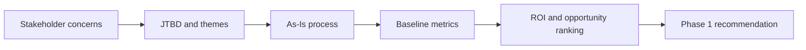

import Tabs from '@theme/Tabs';
import TabItem from '@theme/TabItem';
import LearningObjectiveComponent from '@theme/LearningObjectiveComponent'
import LockedContent from "@theme/LockedContent";

<LearningObjectiveComponent />

## Pre work

### Set up

If nobody has done so already, copy and paste this command into Slack.

```
/prework Case Study and Discovery Framing
```

### Research

:::info Task

Research business analyst roles. What do they involve? What are the key skills/tools/attributes they need?

:::

### Research

:::info Task

Research online for the following terms:

- What is a discovery phase in product or transformation work?
- What is the difference between an operational pain point and a requirement?
- Why do executive stakeholders often ask for evidence before agreeing scope?

:::

### Experiment

:::info Task

Read the [provided case study](https://sigma-resources-public.s3.eu-west-2.amazonaws.com/tba-datasets/pvc/Case+Study-+Pritzki+Veterinary+Clinic.pdf) and write down:

- Three numbers that show the scale of the problem
- Two risks that could make the project fail
- One question you would ask each of the stakeholders

:::

### Submission

:::info Submission

Please share your answers in the Slack thread.

:::

## Workshop

<LockedContent password="ownership">

### Introduction

**Ask** trainees to explain what a business analyst does.

**Highlight** the idea of working on complex **business** problems: turning unclear requirements/data into actionable plans/results.

**Discuss** the skills/attributes a good analyst needs:

- Communication
- Independence
- Solution-focused

**Highlight** that technical skills are involved, but not the priority. The priority is always results.

### Case Study

**Ask** trainees to summarise the PVC case study's main problem in one sentence.

> PVC is losing time, clients, and money because scheduling is a bottleneck.

**Question**

**Gather** the numbers trainees noticed in the pre-work and write them visibly on a board.

- 12000 cases over 6 months
- 2-week/2-day waiting times
- 4% year-on-year growth
- 20% of feedback mentions scheduling
- Customer satisfaction has decreased by 18% in the last two years

**Discuss** why those numbers matter differently to operation staff and management.

**Highlight** that this week is not about jumping to a design too early; it is about proving what the real problems are and which opportunities are worth acting on.

### Stakeholders and tensions

**Ask** trainees 

**Draw** a simple three-column table labelled Finance, Customer Response, Vets, Management.

**Challenge** trainees to place stakeholder concerns into the right column.

**Grant** trainees 5 minutes in pairs to fill the table.

**Gather** the room and correct any concern that has been over-simplified.

**Stress** that strong business analysis often starts by noticing where stakeholders agree and where they do not.

### Scope Management

**State** that stakeholders often have lots of different needs, but no analyst can fix every possible problem at once. We need to prioritise, order, and sometimes also exclude.

**Introduce** the idea that pushing back--professionally, politely, with evidence and justifications--is a key aspect of being an effective analyst. 

**Warn** that analysts who say 'yes' to everything at the start often end up failing to meet expectations and working under increased pressure.

**Identify** the aspects that might make a particular stakeholder desire fall out-of-scope:

- Relevance to the current project
- Complexity
- Expense
- Time commitment

**Ask** trainees to identify any aspects of the PVC brief which should be ruled out-of-scope for this project.

**Nudge** them towards the CEO's suggestion of replacing in-person appointments with AI-powered telehealth.

**Explain** that it's valid to rule this out, but we'll need to argue for it.

**Give** trainees ~5 minutes in breakout rooms to discuss why this should be ruled out-of-scope, and how they would justify it to the CEO.

**Share** and critique different responses.

### What good discovery looks like

**Introduce** discovery as the phase where analysts reduce ambiguity before delivery teams commit to building something.

**Explain** that discovery is not just note-taking; it is structured problem-solving.

**Show** a simple discovery chain on the board:



**Highlight** that if trainees skip one link in that chain, later outputs become weak.

**Discuss** examples of weak discovery statements and improve them together.

> Weak: "The scheduling system is confusing and slow."
>
> Better: "Internal staff manually communicate about appointments between different vets and different sites; this means that scheduling takes a long time to arrange and has limited visibility, leading to lower client satisfaction."

### Demonstration: writing a strong problem statement

**Demonstrate** how to turn scattered facts into a short problem statement.

**Talk** through this structure:

- What is happening now?
- Why does it fail at scale?
- What business consequence does that create?
- Why is change needed now?

**Show** a model answer coaches can build live with trainees:

> PVC's data management processes relies on a range of different communication methods to manage a large client base and complex cases. Because of this fragmented and non-standard approach, scheduling and tracking are both complex and varied processes, customers experience longer wait times, and the business has less visibility over how work is being done and customer responses to it. This leads to lower customer feedback, and potentially decreased revenue in the long term.
> 
> These problems will only increase with scale, as each new customer or employee adds further to the management burden. As PVC intends to scale in the near future, developing a more effective system is a priority.

**Warn** trainees that broad transformation language usually sounds polished but gives delivery teams almost nothing usable.

### Demonstration: discovery questions that lead to evidence

**Ask** trainees what makes a discovery question useful.

> It should point toward evidence, trade-offs, or decisions rather than just opinions.

**Show** several example questions and discuss why they help & how/if they could be refined:

- What data is collected in feedback?
- What constitutes a case for PVC?
- How are schedules communicated to PVC staff?
- What are the most common client interactions?
- What are the priorities of the system from a client perspective?

**Challenge** trainees to improve one vague question into an evidence-oriented question.

**Grant** them 4 minutes.

**Gather** improved examples and note especially good phrasing.

### Mini challenge

**Challenge** trainees in small groups to create a discovery starter pack containing:

- A 3-sentence problem summary
- A list of top stakeholder tensions
- Five discovery questions
- Three evidence sources they would trust most

**Grant** trainees 12 minutes to complete this.

**Circulate** while they work and nudge anyone who jumps too quickly into solution ideas.

**Gather** answers and ask groups to justify why they chose those evidence sources.

**Highlight** that stakeholder interviews, activity data, finance assumptions, and process observation all play different roles.

### Conclusion

**Ask** trainees to each say one sentence beginning with, "Before recommending Phase 1, I need to prove..."

**Confirm** that the best answers refer to evidence, value, workflow suitability, or adoption risk.

**Stress** that the rest of the week depends on staying disciplined: understand the problem first, then quantify it, then recommend action.

</LockedContent>
