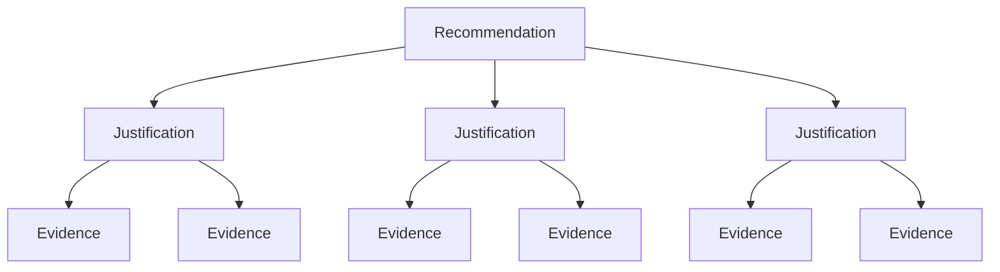

import Tabs from '@theme/Tabs';
import TabItem from '@theme/TabItem';
import LearningObjectiveComponent from '@theme/LearningObjectiveComponent'
import LockedContent from "@theme/LockedContent";

<LearningObjectiveComponent />

## Pre work

### Set up

If nobody has done so already, copy and paste this command into Slack.

```
/prework Executive Briefings
```

### Research

:::info Task

Research online for the following terms:

- What is The Pyramid Principle?
- Why do executive presentations often lead with the recommendation first?
- What makes a business case feel credible rather than over-sold?

:::

### Prepare

:::info Task

Write a one-sentence recommendation to solve the problem of climate change.

Come up with

- Three supporting reasons for your recommendation
- At least one piece of evidence that supports each reason

Bring your draft to the workshop.

:::

### Submission

:::info Submission

Please share your answers in the Slack thread.

:::

## Workshop

<LockedContent password="ownership">

### Introduction

**Ask** trainees what usually goes wrong in junior presentations to leadership.

> Too much background, weak recommendation, too many slides, unclear ask, or no visible trade-offs.

**Explain** that leadership is not asking for a diary of the work completed; they are asking what should be approved and why.

### The Pyramid Principle

**Introduce** the core idea: answer first, then support with grouped arguments.

**Show** the structure visually:



**Highlight** that the support points should be grouped logically, rather than chronologically. The aim is not to reproduce the work done so far.

### Demonstration: top-line recommendation

**Demonstrate** a strong one-sentence recommendation:

> We should solve climate change by building an enormous space mirror to reflect 90% of the sun's rays away from Earth.

**Ask** trainees why this is stronger than "lower the global temperature".

> It is specific about scope, intent, and operating model.

**Stress** that "strong" is not the only important consideration here (accurate & practical are also relevant, for example), but strength is a key part of an effective briefing.

### Challenge

**Get** trainees to redraft their recommendations from the pre-work to be stronger and more actionable.

**Ask** trainees to share their original recommendations and their strengthened versions.

### Building the support lines

**Explain** that a single strong recommendation does nothing unless it's convincing. A strategy needs justifications, and a justification needs evidence behind it.

**State** that justifications can take various forms:

- ROI ('how do we benefit?')
- Urgency ('why now?')
- Discovery evidence/Pain points
- Risk

**Stress** that all of the work done in analysing the problem can now be part of making the briefing.

**Highlight** that not every justification needs equal space; executives usually need the recommendation and the evidence trail, not every detail from the analysis process.

### Challenge (Pairs)

**Divide** trainees into pairs

**Give** each pair a strong (not necessarily grounded) recommendation to brief on.

<details>
<summary>Click here for possible examples.</summary>
- Veganism should be legally mandated
- Film actors should be selected randomly from the population
- Building a Mars colony should be a global priority
</details>

**Challenge** trainees to develop a short plan (as a mind map or similar) of how they would structure a briefing.

**Direct** them to include:

- A one-sentence recommendation
- Three support lines
- One explicit ask

**Grant** trainees ~10 minutes to prepare.

**Gather** volunteers to deliver their briefing aloud.

**Confirm** clarity where it exists and gently tighten anything that still sounds like a project update rather than a recommendation.

### Final coaching points

**Warn** trainees against hiding risk to sound more persuasive.

**Explain** that honest exclusions, assumption ranges, and change mitigations usually increase credibility.

**Encourage** them to end clearly; a briefing is not a general introduction but a call to action.

### Conclusion

**Confirm** that the strongest asks are specific about scope, purpose, and next step.

**Stress** that a joined-up recommendation is the clearest sign they can think like a technical business analyst rather than just produce isolated artefacts.

</LockedContent>
