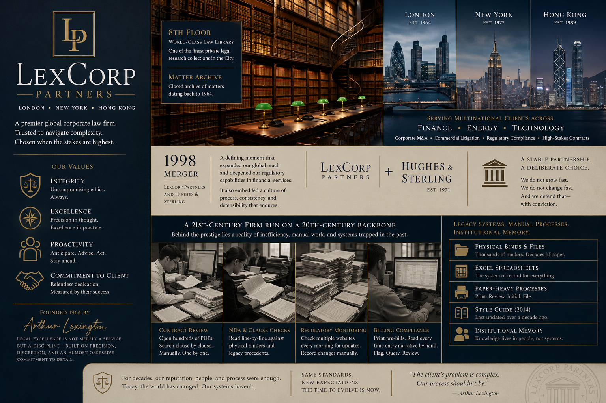

import StakeholderBio from "@theme/StakeholderBio";

LexCorp Partners is a premier global corporate law firm with offices in London, New York, and Hong Kong. Founded by Arthur Lexington on the principle that legal excellence is not merely a service but a discipline - one built on precision, discretion, and an almost obsessive commitment to detail - the firm has spent six decades earning a reputation that places it among the leading names in corporate law.

The firm's practice spans corporate M&A advisory, commercial litigation, regulatory compliance, and high-stakes contract work for multinational clients across finance, energy, and technology sectors. It is the kind of firm that gets called when the stakes are too high for anyone else. Senior Partners are recognised authorities in their fields, and the client list reads like a register of the FTSE 100 and Fortune 500. Core to the firm's identity are three values that Arthur Lexington insisted be non-negotiable: Integrity, Proactivity, and a relentless commitment to the client. These values still appear in every induction workbook today.

LexCorp's character was shaped significantly by the 1998 merger with Hughes & Sterling, a mid-sized transatlantic firm with deep regulatory roots in financial services. The merger expanded LexCorp's geographic footprint and broadened its practice across jurisdictions, and it embedded a culture of extreme process-consciousness that prizes institutional consistency and defensibility above speed. Every procedure has a history. Every rule has a reason, even if no one can quite remember what it was.

The firm maintains a world-class physical law library on the 8th floor, considered one of the finest private legal research collections in the City, and a closed matter archive that dates to 1964. The partnership structure has remained deliberately stable over the decades. LexCorp does not grow fast and it does not change fast. That is a deliberate choice that has served the firm well, and one that its Senior Partners will defend with considerable conviction.

For decades, this combination of prestige, stability, and meticulous process has been enough. Behind that prestige, however, lies a firm that is operationally stuck in the past. Its daily processes - contract review, billing compliance, conflict-of-interest checks, regulatory monitoring - are almost entirely manual, paper-heavy, and dependent on institutional memory rather than systems.

The firm's [Employee Workbook](./02-handbook.md) lays bare the reality. Junior associates and paralegals, billed out at premium rates, spend the majority of their time acting as human copy-paste machines. They open hundreds of PDF contracts one by one, manually searching for specific clauses. They read NDA terms line-by-line against a physical binder. They check regulatory websites every morning for updates. They print pre-bills and read every time entry narrative by hand. LexCorp is running a 21st-century legal practice on a 20th-century backbone of Excel spreadsheets, physical binders, and a style guide last updated in 2014.

## Your Role

You are a Technical Business Analyst brought in on an "impossible" mandate: modernise LexCorp's operations without breaking its strict culture or triggering its security anxieties.

You will work this engagement in a pair, sharing responsibility for the analysis, the build, and every client meeting with LexCorp.

Your first task is discovery. You must mine the Employee Workbook to separate the real operational pain points from the kitchen-etiquette distractions. You need to understand _where_ the firm bleeds time and money, _who_ is affected, and _why_ the current processes exist in the form they do. From there, you will begin to architect a solution that feels like a **helper** rather than a **replacer**, one that augments the existing workforce rather than threatening it.

You are not just building a tool. You are performing a delicate piece of corporate surgery on a patient that is deeply suspicious of the surgeon.

## Stakeholders

For this week, you have three internal stakeholders.

<StakeholderBio name="Melody Harris" role="Managing Partner" imageFilename="melody_harris">

Melody runs LexCorp Partners. She steered the firm through the aftermath of the August Incident, and her authority within the partnership is absolute. She is the one who authorised bringing in external technology consultants, but she did so reluctantly, and only after the firm lost two major client pitches because competitors could turn around conflict checks and contract reviews in a fraction of the time.

Melody's mandate expanded after the August Incident to include not only revenue protection but also governance oversight. She now holds final authority over both business approval and compliance vetting for any initiative that touches client data, document handling, or information access. She requires clear evidence that any modernisation initiative will protect the firm's revenue, enhance (not degrade) its security posture, and demonstrate rigorous data residency, access logging, and audit trail controls. She will not entertain any proposal that cannot demonstrate clear ROI within 12 months, and she will personally veto anything that she believes undermines the firm's security posture or does not meet her governance requirements. She expects your discovery outputs to be rigorous, quantified, and presented with the same precision she demands of her legal briefs. She also expects your solutions to be defensible to the SRA if asked.

</StakeholderBio>

<StakeholderBio name="Kelvin Tran" role="Head of Legal Operations" imageFilename="kelvin_tran">

Kelvin oversees the paralegal pool, the document review pipeline, the NDA triage process, and the contract audit workflow. He lives the inefficiency every day: his team is drowning in PDFs, his inbox is a queue of Senior Partner requests, and he has lost three experienced paralegals in the past year to firms that offered them better tools and less drudgery.

Kelvin is the most enthusiastic stakeholder about modernisation, but his enthusiasm is tempered by realism. He has seen "transformation" projects before: ambitious slide decks that promised the world and delivered a half-built portal that nobody used. He wants to see that you understand how his team _actually_ works, not how a process diagram says they should. If your As-Is mapping does not reflect the workarounds, the email chains, and the physical binder lookups, he will not trust your To-Be vision.

Kelvin is your strongest internal ally, but only if you earn his trust through accuracy.

</StakeholderBio>

## The Task

LexCorp's leadership has approved a discovery-to-delivery engagement under the banner **AI & Automation**. Your mandate is twofold: first, build a compelling, stakeholder-approved business case for automating the firm's highest-pain manual processes; then, design and **build working automation prototypes** that prove the concept in practice.

This is not a theoretical exercise. By the end of this week, you will have delivered functioning automations that LexCorp's staff can evaluate. Getting to that point means working through a complex stakeholder landscape, managing competing priorities, and earning buy-in from people who are predisposed to say no.

The work is broken into five phases:

- **Discovery** (~20% of your time)
  1. **Decode the Workbook** - Analyse the Employee Workbook to build a structured process inventory, separating genuine operational pain from bureaucratic noise. Map each process to the stakeholders it impacts.
  2. **Map & Prioritise** - Create detailed As-Is process maps for the highest-value workflows, identify automation intervention points, and rank opportunities by ROI, complexity, and organisational risk.
  3. **Design the To-Be** - Design future-state workflows with AI/automation integrated, define a scoped Phase 1 pilot, write user stories with acceptance criteria, and plan how to communicate the proposal to each stakeholder.
- **Build & Deliver** (~70% of your time)
  1. **Build the Automations** - Build working prototypes of your recommended automations, implement compliance controls and audit trails, and test against realistic scenarios including edge cases.
- **Communicate & Handover** (~10% of your time)
  1. **Stakeholder Briefing** - Present your findings and demonstrate your prototypes to stakeholders, assemble a complete handover package with governance evidence for Melody, and ensure compliance controls are clearly documented.

### Managing Competing Stakeholder Needs

The two stakeholders you are working with do not want the same things, and part of your job is to manage that tension:

- **Melody** cares about revenue protection, reputational safety, and governance. She will approve what she can defend to the partnership and what meets her compliance standards. She holds authority over both business case approval and governance oversight. If your business case has holes or if your solution does not meet her security and compliance requirements, she will find them and she will veto the project.
- **Kelvin** cares about his team's daily reality. He will champion your work internally, but only if your process maps reflect the actual workarounds, email chains, and physical binder lookups that his paralegals deal with every day. If your analysis looks like it was done from a distance, he will lose confidence.

You will need to tailor your communication to each stakeholder. The same automation opportunity might need to be framed as a "revenue accelerator" for Melody (with governance evidence), and a "workload relief" for Kelvin. Melody's decision incorporates both business case ROI and compliance rigor; your communications must address both.

:::warning Important

Not every process _should_ be automated. Part of your value as an analyst is knowing where to draw the line. A process that is manual but low-volume and low-risk may not justify the investment. A process that touches sealed archives or the containment protocol requires Melody's explicit governance approval and must include comprehensive audit trail controls. A process where the workforce has deep emotional attachment to the current way of working may need a phased approach rather than wholesale replacement. Your recommendations, and your builds, must reflect this judgement and address Melody's governance requirements proactively.

:::
